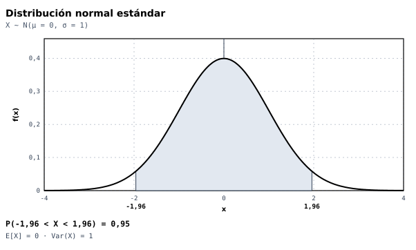
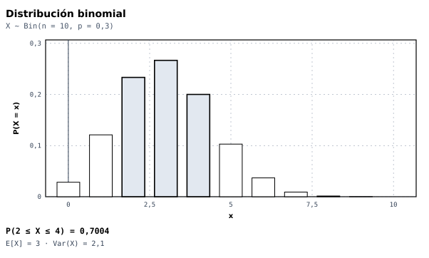
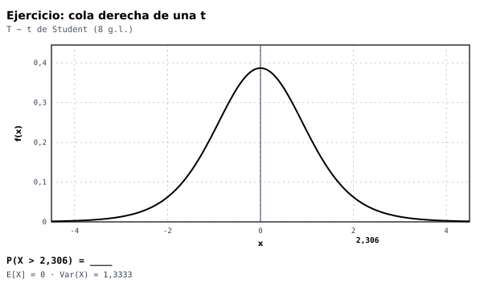

[Manual](../../README.md) › [Matemática aplicada](../README.md) › [Probabilidad](README.md)

# Distribución (`distribution`)

Dibuja la densidad de una distribución continua o la función de masa de una discreta, sombrea
el intervalo pedido y calcula su probabilidad, además de la esperanza y la varianza.

## Qué calcula

- La probabilidad exacta con la función de distribución: la normal por la función gamma incompleta, la t por la beta incompleta, la χ² por la gamma incompleta y las discretas sumando la masa.

## Campos

| Campo | Tipo | Valores y valor por defecto | Descripción |
| :--- | :--- | :--- | :--- |
| `type` | texto | `distribution` | Obligatorio. |
| `dist` | texto | `normal`, `uniform`, `exponential`, `t`, `chi2`, `binomial`, `poisson`, `geometric` · por defecto `normal` | `normal`, `uniform`, `exponential`, `t`, `chi2`, `binomial`, `poisson` o `geometric`. |
| `mean` | número |  | En la normal, la media. |
| `sd` | número |  | En la normal, el desvío. |
| `a` | número |  | En la uniforme, el extremo inferior. |
| `b` | número |  | En la uniforme, el extremo superior. |
| `lambda` | número |  | En la exponencial y la Poisson, λ. |
| `df` | número |  | En la t y la χ², los grados de libertad. |
| `n` | número |  | En la binomial, los ensayos. |
| `p` | número |  | En la binomial y la geométrica, la probabilidad de éxito. |
| `interval` | lista |  | El intervalo `[a, b]`; `null` es −∞ o +∞. En las discretas, los extremos van incluidos. |
| `showMean` | sí/no |  | Marca la media. |
| `blank` | sí/no |  | Oculta el área sombreada y la probabilidad. |

Además, los campos comunes a todos los tipos: `title`, `subtitle`, `id`, `inkSaver` y `theme` (ver [Campos comunes](../../campos-comunes.md)).

## Modo ejercicio

Campos que dejan casilleros para completar: `blank`.

## Ejemplos

### Distribución normal estándar

```yaml
type: distribution
title: Distribución normal estándar
dist: normal
mean: 0
sd: 1
interval: [-1.96, 1.96]
```

[](https://ingcom-unrn.github.io/dibu-web/#t=dHlwZTogZGlzdHJpYnV0aW9uCnRpdGxlOiBEaXN0cmlidWNpw7NuIG5vcm1hbCBlc3TDoW5kYXIKZGlzdDogbm9ybWFsCm1lYW46IDAKc2Q6IDEKaW50ZXJ2YWw6IFstMS45NiwgMS45Nl0K)

[Abrir en el editor](https://ingcom-unrn.github.io/dibu-web/#t=dHlwZTogZGlzdHJpYnV0aW9uCnRpdGxlOiBEaXN0cmlidWNpw7NuIG5vcm1hbCBlc3TDoW5kYXIKZGlzdDogbm9ybWFsCm1lYW46IDAKc2Q6IDEKaW50ZXJ2YWw6IFstMS45NiwgMS45Nl0K) para explorarlo y modificarlo.

### Distribución binomial

```yaml
type: distribution
title: Distribución binomial
dist: binomial
n: 10
p: 0.3
interval: [2, 4]
```

[](https://ingcom-unrn.github.io/dibu-web/#t=dHlwZTogZGlzdHJpYnV0aW9uCnRpdGxlOiBEaXN0cmlidWNpw7NuIGJpbm9taWFsCmRpc3Q6IGJpbm9taWFsCm46IDEwCnA6IDAuMwppbnRlcnZhbDogWzIsIDRdCg)

[Abrir en el editor](https://ingcom-unrn.github.io/dibu-web/#t=dHlwZTogZGlzdHJpYnV0aW9uCnRpdGxlOiBEaXN0cmlidWNpw7NuIGJpbm9taWFsCmRpc3Q6IGJpbm9taWFsCm46IDEwCnA6IDAuMwppbnRlcnZhbDogWzIsIDRdCg) para explorarlo y modificarlo.

### Ejercicio: cola derecha de una t

```yaml
type: distribution
title: "Ejercicio: cola derecha de una t"
dist: t
df: 8
interval: [2.306, null]
blank: true
```

[](https://ingcom-unrn.github.io/dibu-web/#t=dHlwZTogZGlzdHJpYnV0aW9uCnRpdGxlOiAiRWplcmNpY2lvOiBjb2xhIGRlcmVjaGEgZGUgdW5hIHQiCmRpc3Q6IHQKZGY6IDgKaW50ZXJ2YWw6IFsyLjMwNiwgbnVsbF0KYmxhbms6IHRydWUK)

[Abrir en el editor](https://ingcom-unrn.github.io/dibu-web/#t=dHlwZTogZGlzdHJpYnV0aW9uCnRpdGxlOiAiRWplcmNpY2lvOiBjb2xhIGRlcmVjaGEgZGUgdW5hIHQiCmRpc3Q6IHQKZGY6IDgKaW50ZXJ2YWw6IFsyLjMwNiwgbnVsbF0KYmxhbms6IHRydWUK) para explorarlo y modificarlo.

## Ver también

[`venn`](venn.md)
