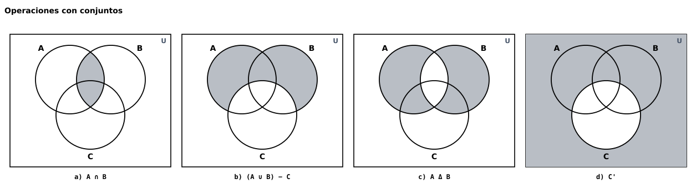
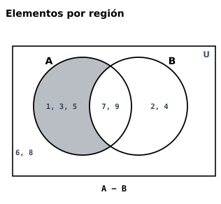

[Manual](../../README.md) › [Matemática aplicada](../README.md) › [Probabilidad](README.md)

# Diagrama de Venn (`venn`)

Dibuja dos o tres conjuntos dentro del universo y sombrea las regiones que forman una
expresión de conjuntos. Con varias expresiones, un diagrama por cada una, rotulados a), b)…
Los elementos o cantidades de cada región se pueden escribir adentro.

## Qué calcula

- Las regiones de la expresión, con unión, intersección, diferencia, diferencia simétrica y complemento.

## Campos

| Campo | Tipo | Valores y valor por defecto | Descripción |
| :--- | :--- | :--- | :--- |
| `type` | texto | `venn` | Obligatorio. |
| `sets` | lista |  | Los nombres de los conjuntos (2 o 3). |
| `shade` | lista o texto |  | Una expresión o una lista (hasta 8): `∪` (`\|`, `+`), `∩` (`&`, `·` o yuxtaposición), `−` (`\`), `Δ` (`^`) y el complemento con `'` o `¬`. `U` es el universo. |
| `regions` | objeto |  | Lo que va en cada región, por los conjuntos que la forman: `"A": [1, 3]`, `"A,B": [7]`, `U` (afuera de todos). |
| `counts` | objeto |  | Cantidades por región, con las mismas claves que `regions`. |
| `blank` | sí/no |  | Dibuja los conjuntos sin sombrear, para sombrear la expresión. |

Además, los campos comunes a todos los tipos: `title`, `subtitle`, `id`, `inkSaver` y `theme` (ver [Campos comunes](../../campos-comunes.md)).

## Modo ejercicio

Campos que dejan casilleros para completar: `blank`.

## Ejemplos

### Operaciones con conjuntos

```yaml
type: venn
title: Operaciones con conjuntos
sets: [A, B, C]
shade: ["A ∩ B", "(A ∪ B) − C", "A Δ B", "C'"]
```

[](https://ingcom-unrn.github.io/dibu-web/#z=K6ksSLVSKEvNy-MqySzJAbL9C1KLEpMz8_NSixWS8_NAOKs0ryS_mKs4taTYSiHaUUfBSUfBOZarOCMxBaghWslR4VHHSgUnJR0FJQ0Qe5WCkyaQmqTgDBJyVDg3BSLprK4UywUA)

[Abrir en el editor](https://ingcom-unrn.github.io/dibu-web/#z=K6ksSLVSKEvNy-MqySzJAbL9C1KLEpMz8_NSixWS8_NAOKs0ryS_mKs4taTYSiHaUUfBSUfBOZarOCMxBaghWslR4VHHSgUnJR0FJQ0Qe5WCkyaQmqTgDBJyVDg3BSLprK4UywUA) para explorarlo y modificarlo.

### Elementos por región

```yaml
type: venn
title: Elementos por región
sets: [A, B]
shade: "A − B"
regions:
  A: [1, 3, 5]
  "A,B": [7, 9]
  B: [2, 4]
  U: [6, 8]
```

[](https://ingcom-unrn.github.io/dibu-web/#z=K6ksSLVSKEvNy-MqySzJAbJdc1JzU_NK8osVCvKLFIpS0zMPb87jKk4tKbZSiHbUUXCK5SrOSEwBqlRyVHjUMUnBSYkLpCo_r9iKS0HBEajKUEfBWEfBNBbIVXLUcVICCpnrKFiC-E5AtpGOggmIHQpkm-koWMRyAQA)

[Abrir en el editor](https://ingcom-unrn.github.io/dibu-web/#z=K6ksSLVSKEvNy-MqySzJAbJdc1JzU_NK8osVCvKLFIpS0zMPb87jKk4tKbZSiHbUUXCK5SrOSEwBqlRyVHjUMUnBSYkLpCo_r9iKS0HBEajKUEfBWEfBNBbIVXLUcVICCpnrKFiC-E5AtpGOggmIHQpkm-koWMRyAQA) para explorarlo y modificarlo.

## Ver también

[`distribution`](distribution.md)
