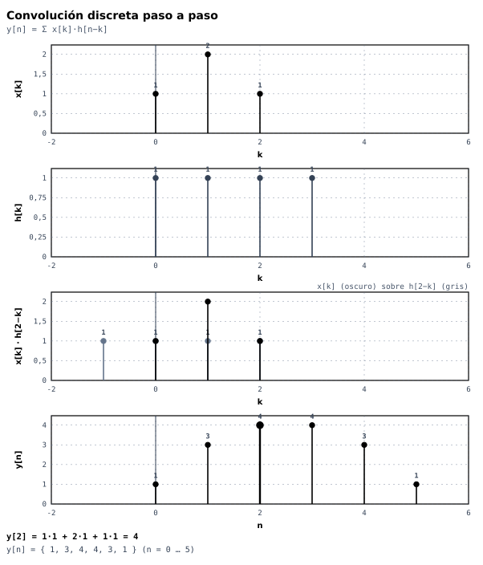

[Manual](../../README.md) › [Matemática aplicada](../README.md) › [Señales y sistemas](README.md)

# Convolución (`convolution`)

Calcula y dibuja la convolución discreta y[n] = Σ x[k]·h[n−k]: las secuencias x[k] y h[k] y
el resultado y[n]. Con `step`, agrega el paso intermedio: h[n−k] volteada y desplazada sobre
x[k], con la cuenta de esa muestra.

## Qué calcula

- y[n] completa y, con `step`, los productos de la muestra elegida.

## Campos

| Campo | Tipo | Valores y valor por defecto | Descripción |
| :--- | :--- | :--- | :--- |
| `type` | texto | `convolution` | Obligatorio. |
| `x` | lista |  | Las muestras de x (hasta 64). |
| `xStart` | número |  | El índice de la primera muestra de x (por omisión 0). |
| `h` | lista |  | Las muestras de h. |
| `hStart` | número |  | El índice de la primera muestra de h. |
| `step` | número |  | Un n para mostrar el paso de voltear y desplazar. |
| `values` | sí/no |  | Escribe y[n] como lista debajo (por omisión, sí). |
| `blank` | sí/no |  | Oculta y[n] y el resultado del paso. |

Además, los campos comunes a todos los tipos: `title`, `subtitle`, `id`, `inkSaver` y `theme` (ver [Campos comunes](../../campos-comunes.md)).

## Modo ejercicio

Campos que dejan casilleros para completar: `blank`.

## Ejemplos

### Convolución discreta paso a paso

```yaml
type: convolution
title: Convolución discreta paso a paso
x: [1, 2, 1]
h: [1, 1, 1, 1]
step: 2
```

[](https://ingcom-unrn.github.io/dibu-web/#z=K6ksSLVSSM7PK8vPKS3JzM_jKsksyQEKOUOEkjMPb85TSMksTi5KLUlUKEgszleAUFwVVgrRhjoKRjoKhrFcGRAOFMVyFZekFlgpGHEBAA)

[Abrir en el editor](https://ingcom-unrn.github.io/dibu-web/#z=K6ksSLVSSM7PK8vPKS3JzM_jKsksyQEKOUOEkjMPb85TSMksTi5KLUlUKEgszleAUFwVVgrRhjoKRjoKhrFcGRAOFMVyFZekFlgpGHEBAA) para explorarlo y modificarlo.

## Ver también

[`signal`](signal.md), [`fourier`](fourier.md), [`sampling`](sampling.md)
