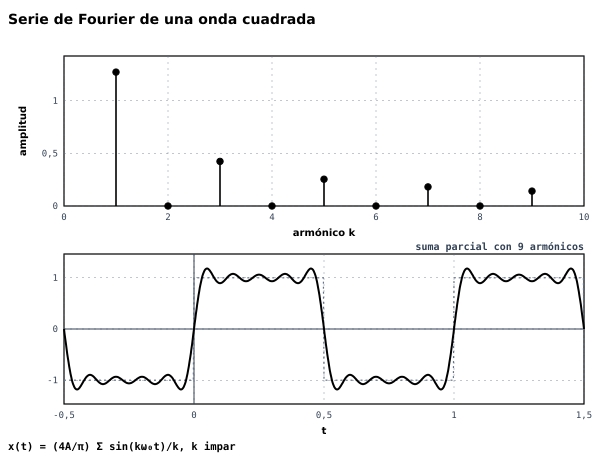
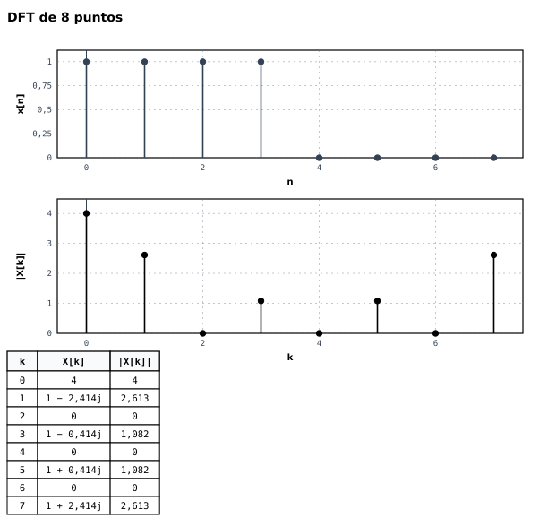

[Manual](../../README.md) › [Matemática aplicada](../README.md) › [Señales y sistemas](README.md)

# Fourier (`fourier`)

Con `sequence`, calcula la DFT de una secuencia y dibuja la secuencia, el módulo |X[k]| (y la
fase) y una tabla con cada X[k]. Con `wave`, dibuja el espectro de amplitud de la serie de
Fourier de una onda cuadrada, diente de sierra o triangular, y la suma parcial frente a la
onda ideal.

## Qué calcula

- La DFT de N puntos.
- Los coeficientes de la serie y la suma parcial con los primeros armónicos.

## Campos

| Campo | Tipo | Valores y valor por defecto | Descripción |
| :--- | :--- | :--- | :--- |
| `type` | texto | `fourier` | Obligatorio. |
| `sequence` | lista |  | La secuencia, para la DFT (hasta 128 muestras). |
| `phase` | sí/no |  | Agrega la fase de X[k]. |
| `table` | sí/no |  | La tabla de X[k] (por omisión, sí, hasta 16 muestras). |
| `wave` | texto |  | `square`, `sawtooth` o `triangle`. |
| `harmonics` | número |  | La cantidad de armónicos (de 1 a 60, por omisión 7). |
| `amplitude` | número |  | La amplitud A de la onda. |
| `period` | número |  | El período T. |
| `blank` | sí/no |  | Oculta el espectro (y la suma parcial) y los valores de la tabla. |

Además, los campos comunes a todos los tipos: `title`, `subtitle`, `id`, `inkSaver` y `theme` (ver [Campos comunes](../../campos-comunes.md)).

## Modo ejercicio

Campos que dejan casilleros para completar: `blank`.

## Ejemplos

### Serie de Fourier de una onda cuadrada

```yaml
type: fourier
title: Serie de Fourier de una onda cuadrada
wave: square
harmonics: 9
```



### DFT de 8 puntos

```yaml
type: fourier
title: DFT de 8 puntos
sequence: [1, 1, 1, 1, 0, 0, 0, 0]
```



## Ver también

[`signal`](signal.md), [`convolution`](convolution.md), [`sampling`](sampling.md)
