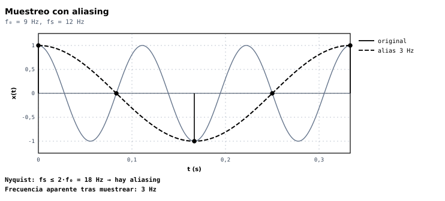
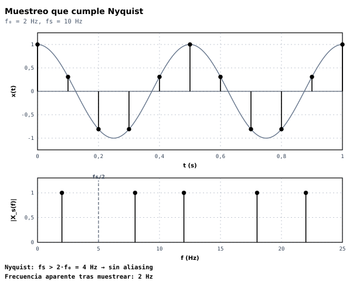

[Manual](../../README.md) › [Matemática aplicada](../README.md) › [Señales y sistemas](README.md)

# Muestreo (`sampling`)

Dibuja un tono senoidal, sus muestras y, si no se cumple Nyquist, el alias que pasa por las
mismas muestras. Debajo, si hay aliasing y la frecuencia aparente. Con `spectrum`, agrega las
réplicas del espectro en k·fs ± f₀.

## Qué calcula

- La frecuencia aparente del tono muestreado.

## Campos

| Campo | Tipo | Valores y valor por defecto | Descripción |
| :--- | :--- | :--- | :--- |
| `type` | texto | `sampling` | Obligatorio. |
| `frequency` | número |  | La frecuencia del tono, en Hz. |
| `fs` | número |  | La frecuencia de muestreo, en Hz. |
| `amplitude` | número |  | La amplitud. |
| `phase` | número |  | La fase, en grados. |
| `periods` | número |  | Cuántos períodos del tono se dibujan (por omisión 3). |
| `reconstruction` | sí/no |  | Dibuja el alias (por omisión, sí). |
| `spectrum` | sí/no |  | Agrega el espectro con las réplicas. |
| `blank` | sí/no |  | Oculta el alias y deja en blanco las conclusiones. |

Además, los campos comunes a todos los tipos: `title`, `subtitle`, `id`, `inkSaver` y `theme` (ver [Campos comunes](../../campos-comunes.md)).

## Modo ejercicio

Campos que dejan casilleros para completar: `blank`.

## Ejemplos

### Muestreo con aliasing

```yaml
type: sampling
title: Muestreo con aliasing
frequency: 9
fs: 12
periods: 3
```

[](https://ingcom-unrn.github.io/dibu-web/#z=K6ksSLVSKE7MLcjJzEvnKsksyQHyfUtTi0uKUvMVkvPzFBJzMhOLQZJpRamFpal5yZVWCpZcacVWCoZGXAWpRZn5KUC2MRcA)

[Abrir en el editor](https://ingcom-unrn.github.io/dibu-web/#z=K6ksSLVSKE7MLcjJzEvnKsksyQHyfUtTi0uKUvMVkvPzFBJzMhOLQZJpRamFpal5yZVWCpZcacVWCoZGXAWpRZn5KUC2MRcA) para explorarlo y modificarlo.

### Muestreo que cumple Nyquist

```yaml
type: sampling
title: Muestreo que cumple Nyquist
frequency: 2
fs: 10
periods: 2
spectrum: true
```

[](https://ingcom-unrn.github.io/dibu-web/#z=FYm7DYAwDAV7T-ERgDI7wA4ovKBI-dsusj2hOenudDY4lju3FMtLGjUtPw2iA5W7gb2tCb5mtyhKYWDV4qfjg4I43jdqGLE-8hdp8DosO14EfQ)

[Abrir en el editor](https://ingcom-unrn.github.io/dibu-web/#z=FYm7DYAwDAV7T-ERgDI7wA4ovKBI-dsusj2hOenudDY4lju3FMtLGjUtPw2iA5W7gb2tCb5mtyhKYWDV4qfjg4I43jdqGLE-8hdp8DosO14EfQ) para explorarlo y modificarlo.

## Ver también

[`signal`](signal.md), [`convolution`](convolution.md), [`fourier`](fourier.md)
