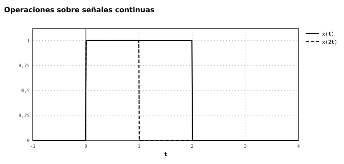
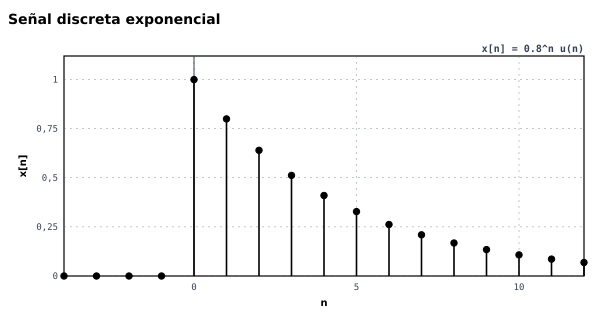

[Manual](../../README.md) › [Matemática aplicada](../README.md) › [Señales y sistemas](README.md)

# Señal (`signal`)

Evalúa una o varias expresiones de t (continuas) o de n (discretas) y las grafica. Las
continuas se dibujan como curvas, juntas con su leyenda o una debajo de la otra; las
discretas, como varillas, una por gráfico.

## Campos

| Campo | Tipo | Valores y valor por defecto | Descripción |
| :--- | :--- | :--- | :--- |
| `type` | texto | `signal` | Obligatorio. |
| `expr` | texto |  | La expresión: `+ − * / ^`, multiplicación implícita (`2t`, `3(t+1)`), `pi` y `e`, y las funciones `sin`, `cos`, `tan`, `exp`, `log` (ln), `log10`, `sqrt`, `abs`, `sgn`, `u` (escalón), `rect`, `tri`, `sinc`, `ramp`, `floor`, `ceil`, `round`, `min`, `max`, `pow`, `mod`, `delta`. |
| `label` | texto |  | El nombre de la señal (`x(t)`). |
| `signals` | lista |  | Varias señales: `{expr, label}` o una lista de expresiones (hasta 6). |
| `domain` | texto | `continuous`, `discrete` · por defecto `continuous` | `continuous` o `discrete`. |
| `variable` | texto |  | La variable (por omisión `t`, o `n` en las discretas). |
| `range` | lista |  | El intervalo de la variable, `[desde, hasta]` (hasta 400 muestras en las discretas). |
| `yrange` | lista |  | El rango del eje vertical, si no se calcula solo. |
| `stack` | sí/no |  | Un gráfico por señal (por omisión, en las discretas). |
| `height` | número |  | La altura de cada gráfico, en píxeles. |
| `blank` | sí/no |  | Dibuja los ejes sin las curvas, para graficarlas. |

Además, los campos comunes a todos los tipos: `title`, `subtitle`, `id`, `inkSaver` y `theme` (ver [Campos comunes](../../campos-comunes.md)).

## Modo ejercicio

Campos que dejan casilleros para completar: `blank`.

## Ejemplos

### Operaciones sobre señales continuas

```yaml
type: signal
title: Operaciones sobre señales continuas
signals:
  - { expr: "rect((t-1)/2)", label: "x(t)" }
  - { expr: "rect((2t-1)/2)", label: "x(2t)" }
range: [-1, 4]
```



### Señal discreta exponencial

```yaml
type: signal
title: Señal discreta exponencial
domain: discrete
expr: "0.8^n u(n)"
label: "x[n]"
range: [-4, 12]
```



## Ver también

[`convolution`](convolution.md), [`fourier`](fourier.md), [`sampling`](sampling.md)
