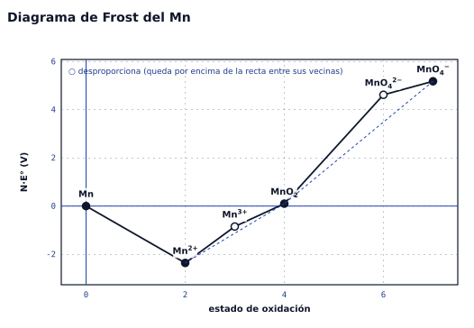

[Manual](../../README.md) › [Química](../README.md) › [Electroquímica](README.md)

# Diagrama de Frost (`frost`)

Dibuja N·E° de cada especie respecto del estado 0 en función del estado de oxidación, con
los mismos datos que un diagrama de Latimer. Las especies que quedan por encima de la recta
entre sus vecinas se desproporcionan.

## Campos

| Campo | Tipo | Valores y valor por defecto | Descripción |
| :--- | :--- | :--- | :--- |
| `type` | texto | `frost` | Obligatorio. |
| `species` | lista |  | Las especies, de la más oxidada a la más reducida. |
| `oxidation` | lista |  | El estado de oxidación de cada especie. |
| `potentials` | lista |  | El E° entre cada par de vecinas. |
| `showDisproportionation` | sí/no |  | Marca las especies que se desproporcionan. |
| `blankLabels` | sí/no |  | Deja en blanco los rótulos. |

Además, los campos comunes a todos los tipos: `title`, `subtitle`, `id`, `inkSaver` y `theme` (ver [Campos comunes](../../campos-comunes.md)).

## Modo ejercicio

Campos que dejan casilleros para completar: `blankLabels`.

## Ejemplos

### Diagrama de Frost del Mn

```yaml
type: frost
title: Diagrama de Frost del Mn
species: [MnO4^-, MnO4^2-, MnO2, Mn^3+, Mn^2+, Mn]
oxidation: [7, 6, 4, 3, 2, 0]
potentials: [0.56, 2.26, 0.95, 1.51, -1.18]
showDisproportionation: true
inkSaver: false
```



## Ver también

[`galvanic_cell`](galvanic_cell.md), [`latimer`](latimer.md)
