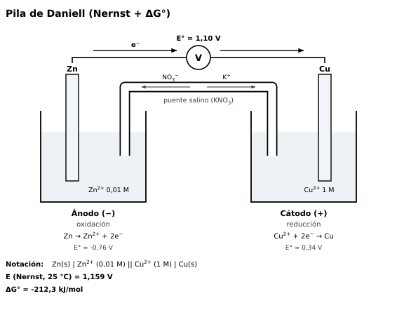

[Manual](../../README.md) › [Química](../README.md) › [Electroquímica](README.md)

# Pila (`galvanic_cell`)

Dibuja una pila con sus dos semiceldas, el puente salino y el circuito externo. El ánodo es la
semicelda de menor E°. Opcionalmente, las semirreacciones, el sentido de los electrones y de
los iones, la notación de la pila, la fem y ΔG.

## Qué calcula

- El ánodo y el cátodo, la fem estándar y con Nernst, y ΔG = −nFE.

## Campos

| Campo | Tipo | Valores y valor por defecto | Descripción |
| :--- | :--- | :--- | :--- |
| `type` | texto | `galvanic_cell` | Obligatorio. |
| `halfCells` | lista |  | Las dos semiceldas: `{couple: "Zn^2+/Zn", E0, n, conc, electrode, solution, reaction}`. |
| `anode` | objeto |  | La semicelda del ánodo, en lugar de `halfCells`. |
| `cathode` | objeto |  | La semicelda del cátodo. |
| `saltBridge` | objeto |  | El puente salino: `name` (por omisión KNO₃), `cation` y `anion`. |
| `showIons` | sí/no |  | Dibuja el movimiento de los iones del puente. |
| `showNotation` | sí/no |  | Escribe la notación de la pila. |
| `showDeltaG` | sí/no |  | Escribe ΔG. |
| `blankPolarity` | sí/no |  | Deja en blanco el signo de los electrodos. |
| `blankReactions` | sí/no |  | Deja en blanco las semirreacciones. |
| `blankPotential` | sí/no |  | Deja la fem en blanco. |
| `blankFlow` | sí/no |  | Deja en blanco el sentido de los electrones. |
| `blankNotation` | sí/no |  | Deja la notación en blanco. |

Además, los campos comunes a todos los tipos: `title`, `subtitle`, `id`, `inkSaver` y `theme` (ver [Campos comunes](../../campos-comunes.md)).

## Modo ejercicio

Campos que dejan casilleros para completar: `blankPolarity`, `blankReactions`, `blankPotential`, `blankFlow`, `blankNotation`.

## Ejemplos

### Pila de Daniell (Nernst + ΔG°)

```yaml
type: galvanic_cell
title: Pila de Daniell (Nernst + ΔG°)
halfCells:
  - {couple: "Cu^2+/Cu", E0: 0.34, n: 2, conc: 1}
  - {couple: "Zn^2+/Zn", E0: -0.76, n: 2, conc: 0.01}
showDeltaG: true
```



### Celda galvánica (para completar)

```yaml
type: galvanic_cell
title: Celda galvánica (para completar)
halfCells:
  - {couple: "Ag^+/Ag", E0: 0.80, n: 1}
  - {couple: "Cu^2+/Cu", E0: 0.34, n: 2}
blankPolarity: true
blankPotential: true
blankReactions: true
blankFlow: true
inkSaver: false
```


## Ver también

[`latimer`](latimer.md), [`frost`](frost.md)
