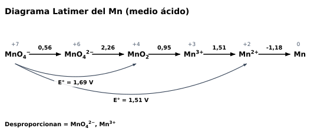

[Manual](../../README.md) › [Química](../README.md) › [Electroquímica](README.md)

# Diagrama de Latimer (`latimer`)

Dibuja las especies de un elemento de la más oxidada a la más reducida con el potencial
estándar entre cada par. Calcula el potencial entre especies no vecinas y marca las que se
desproporcionan.

## Qué calcula

- E° entre dos especies cualesquiera, Σ nE° / Σ n.
- Las especies que se desproporcionan (E° a la derecha mayor que a la izquierda).

## Campos

| Campo | Tipo | Valores y valor por defecto | Descripción |
| :--- | :--- | :--- | :--- |
| `type` | texto | `latimer` | Obligatorio. |
| `species` | lista |  | Las especies, de la más oxidada a la más reducida. |
| `oxidation` | lista |  | El estado de oxidación de cada especie. |
| `potentials` | lista |  | El E° entre cada par de vecinas. |
| `compute` | lista |  | Pares de índices `[i, j]` cuyo potencial se calcula. |
| `showDisproportionation` | sí/no |  | Marca las especies que se desproporcionan. |
| `blankPotentials` | lista |  | Índices de los potenciales que quedan en blanco. |
| `blankComputed` | sí/no |  | Deja en blanco los potenciales calculados. |
| `blankDisproportionation` | sí/no |  | Deja en blanco la desproporción. |

Además, los campos comunes a todos los tipos: `title`, `subtitle`, `id`, `inkSaver` y `theme` (ver [Campos comunes](../../campos-comunes.md)).

## Modo ejercicio

Campos que dejan casilleros para completar: `blankPotentials`, `blankComputed`, `blankDisproportionation`.

## Ejemplos

### Diagrama Latimer del Mn (medio ácido)

```yaml
type: latimer
title: Diagrama Latimer del Mn (medio ácido)
species: [MnO4^-, MnO4^2-, MnO2, Mn^3+, Mn^2+, Mn]
oxidation: [7, 6, 4, 3, 2, 0]
potentials: [0.56, 2.26, 0.95, 1.51, -1.18]
compute: [[0, 2], [0, 4]]
showDisproportionation: true
```

[](https://ingcom-unrn.github.io/dibu-web/#z=LU5LDoIwEN33FLPUWBoo4Ic1S4kHICVpoNFJgGlKiXocz-LFLODmvfm8eW_825oCeu1xMI559H1oS9R3pwcN120OnemhGmE3mA4Jvp8WO9qzyZoWzVRAXY23rIk4rCy3Qi7YpIeV5EqK0Qu74EljODpxOHLIOKQcgjhWzJI3o0fdL56xyMNaChkwFpecQyLyhEOUiOSsWEuDnX14tq7jIFMcFs6UYtODniVO1pElt2T9A72bDfsB)

[Abrir en el editor](https://ingcom-unrn.github.io/dibu-web/#z=LU5LDoIwEN33FLPUWBoo4Ic1S4kHICVpoNFJgGlKiXocz-LFLODmvfm8eW_825oCeu1xMI559H1oS9R3pwcN120OnemhGmE3mA4Jvp8WO9qzyZoWzVRAXY23rIk4rCy3Qi7YpIeV5EqK0Qu74EljODpxOHLIOKQcgjhWzJI3o0fdL56xyMNaChkwFpecQyLyhEOUiOSsWEuDnX14tq7jIFMcFs6UYtODniVO1pElt2T9A72bDfsB) para explorarlo y modificarlo.

### Latimer Cu (en blanco)

```yaml
type: latimer
title: Latimer Cu (en blanco)
species: [Cu^2+, Cu^+, Cu]
oxidation: [2, 1, 0]
potentials: [0.16, 0.52]
compute: [[0, 2]]
blankComputed: true
showDisproportionation: true
blankDisproportionation: true
inkSaver: false
```

[](https://ingcom-unrn.github.io/dibu-web/#z=dY25DsIwEET7_YotQVhRYgkKt6Gko4wcySSLsOLYlg-Ov8dJaGlWmnmafenjSaBRSc8UIOlkSrxsEduMO7J4M8oObg_R06ApCuza3PMDK7xfrwT31mMZOVsgZ9gwrCV4l8gmrcwyqavmVNrqyCUMbvY5FVHX1Qy5lLAopnarR4EpZIL4cK-zjj4478Ly-ydY4Tr4S7WdrupJQeC92Am-)

[Abrir en el editor](https://ingcom-unrn.github.io/dibu-web/#z=dY25DsIwEET7_YotQVhRYgkKt6Gko4wcySSLsOLYlg-Ov8dJaGlWmnmafenjSaBRSc8UIOlkSrxsEduMO7J4M8oObg_R06ApCuza3PMDK7xfrwT31mMZOVsgZ9gwrCV4l8gmrcwyqavmVNrqyCUMbvY5FVHX1Qy5lLAopnarR4EpZIL4cK-zjj4478Ly-ydY4Tr4S7WdrupJQeC92Am-) para explorarlo y modificarlo.

## Ver también

[`galvanic_cell`](galvanic_cell.md), [`frost`](frost.md)
