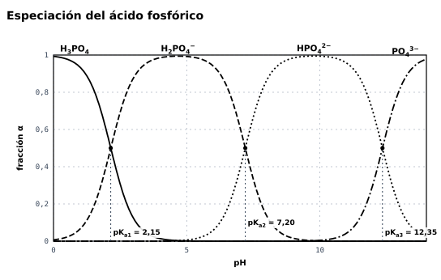
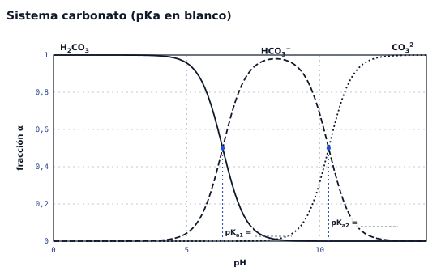

[Manual](../../README.md) › [Química](../README.md) › [Equilibrio y análisis](README.md)

# Especiación (`speciation`)

Dibuja las fracciones α de cada especie de un ácido monoprótico o poliprótico en función del
pH, con los pKa marcados donde se cruzan las curvas.

## Qué calcula

- Las fracciones de cada especie a partir de los pKa.

## Campos

| Campo | Tipo | Valores y valor por defecto | Descripción |
| :--- | :--- | :--- | :--- |
| `type` | texto | `speciation` | Obligatorio. |
| `pKa` | lista |  | Los pKa. |
| `species` | lista |  | Los nombres de las especies (por omisión H₃A, H₂A⁻…). |
| `blankPKa` | sí/no |  | Deja los pKa en blanco. |
| `blankSpecies` | sí/no |  | Deja en blanco los nombres de las especies. |

Además, los campos comunes a todos los tipos: `title`, `subtitle`, `id`, `inkSaver` y `theme` (ver [Campos comunes](../../campos-comunes.md)).

## Modo ejercicio

Campos que dejan casilleros para completar: `blankPKa`, `blankSpecies`.

## Ejemplos

### Especiación del ácido fosfórico

```yaml
type: speciation
title: Especiación del ácido fosfórico
pKa: [2.15, 7.2, 12.35]
species: [H3PO4, H2PO4^-, HPO4^2-, PO4^3-]
```

[](https://ingcom-unrn.github.io/dibu-web/#z=K6ksSLVSKC5ITc5MLMnMz-MqySzJAYq4QoSSMw9vzlNISc1ROLwwOTMlXyEtvzjt8OaizOR8rgLvRCuFaCM9Q1MdBXM9Ix0FQyM9Y9NYLrDO1GKgnIdxgL-JjoKHEZCK0wUyQLQRkAGijXVjuQA)

[Abrir en el editor](https://ingcom-unrn.github.io/dibu-web/#z=K6ksSLVSKC5ITc5MLMnMz-MqySzJAYq4QoSSMw9vzlNISc1ROLwwOTMlXyEtvzjt8OaizOR8rgLvRCuFaCM9Q1MdBXM9Ix0FQyM9Y9NYLrDO1GKgnIdxgL-JjoKHEZCK0wUyQLQRkAGijXVjuQA) para explorarlo y modificarlo.

### Sistema carbonato (pKa en blanco)

```yaml
type: speciation
title: Sistema carbonato (pKa en blanco)
pKa: [6.35, 10.33]
species: [H2CO3, HCO3^-, CO3^2-]
blankPKa: true
inkSaver: false
```

[](https://ingcom-unrn.github.io/dibu-web/#z=HYzBCsIwEETv-xV7VEiLNughVy8FDwo9SoVtWCE0TUKyCv69iZcZ5sEb-SY2WBJbR-JiAHHiK5lcEd4ILeUlBpKIu3Ql5ICLp2DjHuo0-Dj3-qTweOi1nuF_w6XicbjctMKx5rNT2GroZmjuem-i5DeDC-tEH84GX-QLww8)

[Abrir en el editor](https://ingcom-unrn.github.io/dibu-web/#z=HYzBCsIwEETv-xV7VEiLNughVy8FDwo9SoVtWCE0TUKyCv69iZcZ5sEb-SY2WBJbR-JiAHHiK5lcEd4ILeUlBpKIu3Ql5ICLp2DjHuo0-Dj3-qTweOi1nuF_w6XicbjctMKx5rNT2GroZmjuem-i5DeDC-tEH84GX-QLww8) para explorarlo y modificarlo.

## Ver también

[`titration`](titration.md), [`spectrum`](spectrum.md)
