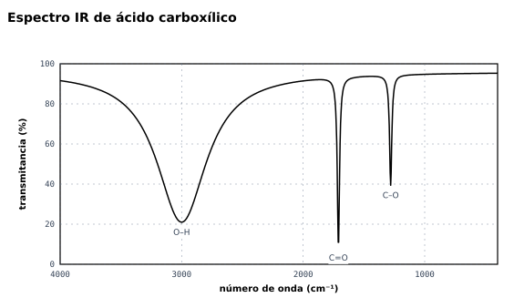
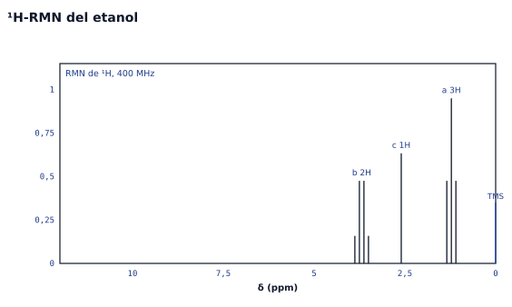
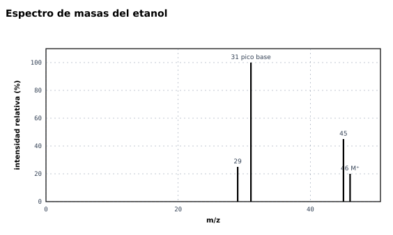

[Manual](../../README.md) › [Química](../README.md) › [Equilibrio y análisis](README.md)

# Espectro (`spectrum`)

Dibuja un espectro: IR (transmitancia con bandas), RMN de protón (señales con su
multiplicidad e integración) o de carbono, UV-visible (absorbancia) y de masas (picos por
m/z), con sus ejes y rótulos.

## Qué calcula

- En RMN, las líneas de cada multiplete por la regla n + 1.

## Campos

| Campo | Tipo | Valores y valor por defecto | Descripción |
| :--- | :--- | :--- | :--- |
| `type` | texto | `spectrum` | Obligatorio. |
| `kind` | texto |  | `ir`, `nmr`, `c13`, `uv` o `ms`. |
| `peaks` | lista |  | En `ir`, `at` (cm⁻¹), `depth`, `width`, `broad`, `label`; en `ms`, `mz`, `intensity`, `label`. |
| `signals` | lista |  | En `nmr`, `shift`, `integration`, `multiplicity` (s, d, t, q…) o `neighbors`, `J`, `label`; en `c13`, `shift` y `label`. |
| `bands` | lista |  | En `uv`, `at` (nm), `absorbance`, `width`. |
| `MHz` | número |  | En RMN, la frecuencia del equipo (por omisión 400). |
| `lineSpacing` | número |  | En RMN, la separación entre líneas de un multiplete (por omisión 5). |
| `showIntegration` | sí/no |  | En RMN, escribe la integración (por omisión, sí). |
| `tms` | sí/no |  | En RMN, la señal del TMS en 0. |
| `range` | lista |  | El rango del eje horizontal. |
| `blankLabels` | sí/no |  | Deja los rótulos en blanco. |

Además, los campos comunes a todos los tipos: `title`, `subtitle`, `id`, `inkSaver` y `theme` (ver [Campos comunes](../../campos-comunes.md)).

## Modo ejercicio

Campos que dejan casilleros para completar: `blankLabels`.

## Ejemplos

### Espectro IR de ácido carboxílico

```yaml
type: spectrum
kind: ir
title: Espectro IR de ácido carboxílico
peaks:
  - {at: 3000, depth: 0.75, broad: true, width: 500, label: "O–H"}
  - {at: 1710, depth: 0.85, label: "C=O"}
  - {at: 1280, depth: 0.55, label: "C–O"}
```

[](https://ingcom-unrn.github.io/dibu-web/#z=Vc3BCcIwAIXhe6Z4eK6SKqEl4EkEPRXcIE0ChkYT0oiKCO7gBA7gFN3ESUzx0Hp-H_-LV685Wq9lDKcDacxRcZhAook2Devf4rDdQWl0L2mUgxShdpfubY10xGvRtJwAU9xE5FhQSrOEfdxz0FnBMtTBiZRNDzrD2ah-Yb2yotaWY1J9Hs_N5D5E8iIfR0o22NWy-pPzcizZWKZqb78)

[Abrir en el editor](https://ingcom-unrn.github.io/dibu-web/#z=Vc3BCcIwAIXhe6Z4eK6SKqEl4EkEPRXcIE0ChkYT0oiKCO7gBA7gFN3ESUzx0Hp-H_-LV685Wq9lDKcDacxRcZhAook2Devf4rDdQWl0L2mUgxShdpfubY10xGvRtJwAU9xE5FhQSrOEfdxz0FnBMtTBiZRNDzrD2ah-Yb2yotaWY1J9Hs_N5D5E8iIfR0o22NWy-pPzcizZWKZqb78) para explorarlo y modificarlo.

### ¹H-RMN del etanol

```yaml
type: spectrum
kind: nmr
title: ¹H-RMN del etanol
tms: true
signals:
  - {shift: 1.22, integration: 3, neighbors: 2, J: 7, label: "a"}
  - {shift: 3.69, integration: 2, neighbors: 3, J: 7, label: "b"}
  - {shift: 2.6, integration: 1, multiplicity: s, label: "c"}
inkSaver: false
```

[](https://ingcom-unrn.github.io/dibu-web/#z=Xc9BCsIwFATQfU4xdF0LtqD4TyCCLvQEaf3WT9O0JL9CEQ_m1pOZndj1zDwYnUcmxJEbDVNvOvFXgu-DUVGXks97vzofT7iyA6v1gzPaR0Jqs4nSeusiGWCFZ7zLTQnroixziFdug1UZPKHK4Vnaez2ENE3pgbDN4WzNjpDZ7PUnVMVmtxDKP6FaCvVCKIvNAljn6CenMjppROd0-bdu0lp8d7EPDoRbesTmCw)

[Abrir en el editor](https://ingcom-unrn.github.io/dibu-web/#z=Xc9BCsIwFATQfU4xdF0LtqD4TyCCLvQEaf3WT9O0JL9CEQ_m1pOZndj1zDwYnUcmxJEbDVNvOvFXgu-DUVGXks97vzofT7iyA6v1gzPaR0Jqs4nSeusiGWCFZ7zLTQnroixziFdug1UZPKHK4Vnaez2ENE3pgbDN4WzNjpDZ7PUnVMVmtxDKP6FaCvVCKIvNAljn6CenMjppROd0-bdu0lp8d7EPDoRbesTmCw) para explorarlo y modificarlo.

### Espectro de masas del etanol

```yaml
type: spectrum
kind: ms
title: Espectro de masas del etanol
peaks:
  - {mz: 46, intensity: 20, label: "M⁺"}
  - {mz: 45, intensity: 45}
  - {mz: 31, intensity: 100, label: "pico base"}
  - {mz: 29, intensity: 25}
```

[](https://ingcom-unrn.github.io/dibu-web/#z=VY0xDoMwEAR7v2JFTSQgOFLcp8wjDFxhYRsrdxQkosi38py8JEhp7G6lGc3KlsiAE43yWIOaXZwMAitx4g9w-5MFEyFYtnwMDxIbF68S2ZmNAk54hadBf6nholBkJ5tB19TwdiBvUN2_70-1Z6ou1F5n7NwWrG2yTnLjgsEy5bHuWv7qXf0A)

[Abrir en el editor](https://ingcom-unrn.github.io/dibu-web/#z=VY0xDoMwEAR7v2JFTSQgOFLcp8wjDFxhYRsrdxQkosi38py8JEhp7G6lGc3KlsiAE43yWIOaXZwMAitx4g9w-5MFEyFYtnwMDxIbF68S2ZmNAk54hadBf6nholBkJ5tB19TwdiBvUN2_70-1Z6ou1F5n7NwWrG2yTnLjgsEy5bHuWv7qXf0A) para explorarlo y modificarlo.

## Ver también

[`titration`](titration.md), [`speciation`](speciation.md)
