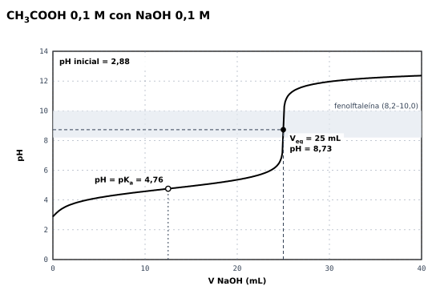
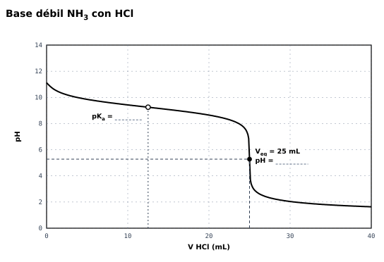

[Manual](../../README.md) › [Química](../README.md) › [Equilibrio y análisis](README.md)

# Titulación (`titration`)

Calcula y dibuja el pH en función del volumen de titulante, con los puntos de equivalencia
que tienen un salto visible, la semiequivalencia, el pH inicial y la franja de viraje del
indicador. También dibuja puntos medidos.

## Qué calcula

- El pH de cada punto por balance de cargas, también para ácidos polipróticos.
- Los puntos de equivalencia, la semiequivalencia y el pH inicial.

## Campos

| Campo | Tipo | Valores y valor por defecto | Descripción |
| :--- | :--- | :--- | :--- |
| `type` | texto | `titration` | Obligatorio. |
| `analyte` | objeto |  | El analito: `kind` (`strong_acid`, `strong_base`, `weak_acid`, `weak_base`), `conc`, `volume`, `pKa` (uno o una lista) o `pKb`, y `charge` de la forma agregada (`-2` para el carbonato). |
| `titrant` | objeto |  | El titulante: `conc` y `name`. |
| `vMax` | número |  | El volumen máximo de titulante. |
| `annotations` | lista |  | `equivalence`, `half`, `initial`. |
| `indicator` | objeto |  | El indicador: `name` y `range` (`[8.2, 10]`). |
| `data` | lista |  | Puntos medidos `[V, pH]`. |
| `blankAnnotations` | sí/no |  | Deja en blanco las anotaciones. |

Además, los campos comunes a todos los tipos: `title`, `subtitle`, `id`, `inkSaver` y `theme` (ver [Campos comunes](../../campos-comunes.md)).

## Modo ejercicio

Campos que dejan casilleros para completar: `blankAnnotations`.

## Ejemplos

### CH3COOH 0,1 M con NaOH 0,1 M

```yaml
type: titration
title: CH3COOH 0,1 M con NaOH 0,1 M
analyte: {kind: weak_acid, pKa: 4.76, conc: 0.1, volume: 25}
titrant: {conc: 0.1, name: NaOH}
indicator: {name: fenolftaleína, range: [8.2, 10]}
annotations: [equivalence, half, initial]
```

[](https://ingcom-unrn.github.io/dibu-web/#z=TY9NCsJADIX3c4ocYCit_3TrRhDtAUQkTKcaOma0RkWkR_IUXsy0IrhLXr6Xl8jj5HMQkgaFIhutggrzxXBeFAtIbQYrcJFhjb_WIGN4iFLPmrjM4e6x3qGj0sJpiTmMkunEdiaXQ5pkFm4xXI_KD8at6aNY1PwHMHbjLqI1upIcSmwU-eqV5xgqweDfL0YL6t-rvJklAwtZum31Io7SP3BR3Z-vdFOanbdwwFBZICYhDFvzAQ)

[Abrir en el editor](https://ingcom-unrn.github.io/dibu-web/#z=TY9NCsJADIX3c4ocYCit_3TrRhDtAUQkTKcaOma0RkWkR_IUXsy0IrhLXr6Xl8jj5HMQkgaFIhutggrzxXBeFAtIbQYrcJFhjb_WIGN4iFLPmrjM4e6x3qGj0sJpiTmMkunEdiaXQ5pkFm4xXI_KD8at6aNY1PwHMHbjLqI1upIcSmwU-eqV5xgqweDfL0YL6t-rvJklAwtZum31Io7SP3BR3Z-vdFOanbdwwFBZICYhDFvzAQ) para explorarlo y modificarlo.

### Ácido poliprótico H3PO4 con NaOH

```yaml
type: titration
title: Ácido poliprótico H3PO4 con NaOH
analyte: {kind: weak_acid, pKa: [2.15, 7.2, 12.35], conc: 0.1, volume: 20}
titrant: {conc: 0.1}
inkSaver: false
```

[](https://ingcom-unrn.github.io/dibu-web/#z=PY1BCsIwEEX3OcUcIIQ2tQg5QUGwgksRGdIIQ2MS2rFSpAvP5BF6MaMLd5_Pe__znJwBJh6QKQaRk8_F-rLURUjRUxrWN5ON0FSHdgM2Bthj2wgM6GfO7LOn0Bl4OOwvmDUJaYcGTlqVtYSt0hJKrar6LL-yNVCoUsIU_f2WbV0s4ncfOE_9gUVQ6I84ucHAFf3oxAc)

[Abrir en el editor](https://ingcom-unrn.github.io/dibu-web/#z=PY1BCsIwEEX3OcUcIIQ2tQg5QUGwgksRGdIIQ2MS2rFSpAvP5BF6MaMLd5_Pe__znJwBJh6QKQaRk8_F-rLURUjRUxrWN5ON0FSHdgM2Bthj2wgM6GfO7LOn0Bl4OOwvmDUJaYcGTlqVtYSt0hJKrar6LL-yNVCoUsIU_f2WbV0s4ncfOE_9gUVQ6I84ucHAFf3oxAc) para explorarlo y modificarlo.

### Base débil NH3 con HCl

```yaml
type: titration
title: Base débil NH3 con HCl
analyte: {kind: weak_base, pKb: 4.75, conc: 0.1, volume: 25}
titrant: {conc: 0.1, name: HCl}
blankAnnotations: true
```

[](https://ingcom-unrn.github.io/dibu-web/#z=K6ksSLVSKMksKUosyczP4wKycoACTonFqQoph1cmZeYo-HkYKyTn5yl4OOdwJeYl5lSWABVUZ2fmpVgplKcmZscnARXrKBR4J1kpmOiZm-qAVCdbKRjoGeoolOXnlOYC1RuZ1nKBbckrAWpGUpCXCJIGml3LlZSTmJftmJeXXwJ2SzHQXUWlqVwA)

[Abrir en el editor](https://ingcom-unrn.github.io/dibu-web/#z=K6ksSLVSKMksKUosyczP4wKycoACTonFqQoph1cmZeYo-HkYKyTn5yl4OOdwJeYl5lSWABVUZ2fmpVgplKcmZscnARXrKBR4J1kpmOiZm-qAVCdbKRjoGeoolOXnlOYC1RuZ1nKBbckrAWpGUpCXCJIGml3LlZSTmJftmJeXXwJ2SzHQXUWlqVwA) para explorarlo y modificarlo.

## Notas

- En la semiequivalencia, el dibujo muestra el pH calculado, que con un pKa bajo ya no es igual al pKa.

## Ver también

[`speciation`](speciation.md), [`spectrum`](spectrum.md)
