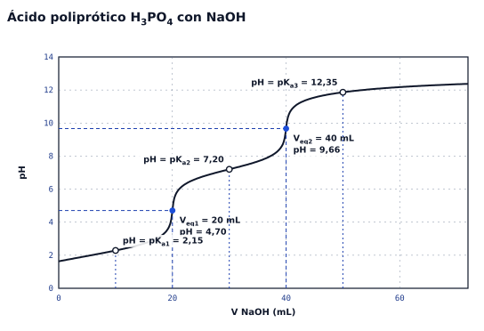

[Manual](../../README.md) › [Química](../README.md) › [Equilibrio y análisis](README.md)

# Titulación (`titration`)

Calcula y dibuja el pH en función del volumen de titulante, con los puntos de equivalencia
que tienen un salto visible, la semiequivalencia, el pH inicial y la franja de viraje del
indicador. También dibuja puntos medidos.

## Qué calcula

- El pH de cada punto por balance de cargas, también para ácidos polipróticos.
- Los puntos de equivalencia, la semiequivalencia y el pH inicial.

## Campos

| Campo | Tipo | Valores y valor por defecto | Descripción |
| :--- | :--- | :--- | :--- |
| `type` | texto | `titration` | Obligatorio. |
| `analyte` | objeto |  | El analito: `kind` (`strong_acid`, `strong_base`, `weak_acid`, `weak_base`), `conc`, `volume`, `pKa` (uno o una lista) o `pKb`, y `charge` de la forma agregada (`-2` para el carbonato). |
| `titrant` | objeto |  | El titulante: `conc` y `name`. |
| `vMax` | número |  | El volumen máximo de titulante. |
| `annotations` | lista |  | `equivalence`, `half`, `initial`. |
| `indicator` | objeto |  | El indicador: `name` y `range` (`[8.2, 10]`). |
| `data` | lista |  | Puntos medidos `[V, pH]`. |
| `blankAnnotations` | sí/no |  | Deja en blanco las anotaciones. |

Además, los campos comunes a todos los tipos: `title`, `subtitle`, `id`, `inkSaver` y `theme` (ver [Campos comunes](../../campos-comunes.md)).

## Modo ejercicio

Campos que dejan casilleros para completar: `blankAnnotations`.

## Ejemplos

### CH3COOH 0,1 M con NaOH 0,1 M

```yaml
type: titration
title: CH3COOH 0,1 M con NaOH 0,1 M
analyte: {kind: weak_acid, pKa: 4.76, conc: 0.1, volume: 25}
titrant: {conc: 0.1, name: NaOH}
indicator: {name: fenolftaleína, range: [8.2, 10]}
annotations: [equivalence, half, initial]
```

[](https://ingcom-unrn.github.io/dibu-web/#t=dHlwZTogdGl0cmF0aW9uCnRpdGxlOiBDSDNDT09IIDAsMSBNIGNvbiBOYU9IIDAsMSBNCmFuYWx5dGU6IHtraW5kOiB3ZWFrX2FjaWQsIHBLYTogNC43NiwgY29uYzogMC4xLCB2b2x1bWU6IDI1fQp0aXRyYW50OiB7Y29uYzogMC4xLCBuYW1lOiBOYU9IfQppbmRpY2F0b3I6IHtuYW1lOiBmZW5vbGZ0YWxlw61uYSwgcmFuZ2U6IFs4LjIsIDEwXX0KYW5ub3RhdGlvbnM6IFtlcXVpdmFsZW5jZSwgaGFsZiwgaW5pdGlhbF0K)

[Abrir en el editor](https://ingcom-unrn.github.io/dibu-web/#t=dHlwZTogdGl0cmF0aW9uCnRpdGxlOiBDSDNDT09IIDAsMSBNIGNvbiBOYU9IIDAsMSBNCmFuYWx5dGU6IHtraW5kOiB3ZWFrX2FjaWQsIHBLYTogNC43NiwgY29uYzogMC4xLCB2b2x1bWU6IDI1fQp0aXRyYW50OiB7Y29uYzogMC4xLCBuYW1lOiBOYU9IfQppbmRpY2F0b3I6IHtuYW1lOiBmZW5vbGZ0YWxlw61uYSwgcmFuZ2U6IFs4LjIsIDEwXX0KYW5ub3RhdGlvbnM6IFtlcXVpdmFsZW5jZSwgaGFsZiwgaW5pdGlhbF0K) para explorarlo y modificarlo.

### Ácido poliprótico H3PO4 con NaOH

```yaml
type: titration
title: Ácido poliprótico H3PO4 con NaOH
analyte: {kind: weak_acid, pKa: [2.15, 7.2, 12.35], conc: 0.1, volume: 20}
titrant: {conc: 0.1}
inkSaver: false
```

[](https://ingcom-unrn.github.io/dibu-web/#t=dHlwZTogdGl0cmF0aW9uCnRpdGxlOiDDgWNpZG8gcG9saXByw7N0aWNvIEgzUE80IGNvbiBOYU9ICmFuYWx5dGU6IHtraW5kOiB3ZWFrX2FjaWQsIHBLYTogWzIuMTUsIDcuMiwgMTIuMzVdLCBjb25jOiAwLjEsIHZvbHVtZTogMjB9CnRpdHJhbnQ6IHtjb25jOiAwLjF9Cmlua1NhdmVyOiBmYWxzZQo)

[Abrir en el editor](https://ingcom-unrn.github.io/dibu-web/#t=dHlwZTogdGl0cmF0aW9uCnRpdGxlOiDDgWNpZG8gcG9saXByw7N0aWNvIEgzUE80IGNvbiBOYU9ICmFuYWx5dGU6IHtraW5kOiB3ZWFrX2FjaWQsIHBLYTogWzIuMTUsIDcuMiwgMTIuMzVdLCBjb25jOiAwLjEsIHZvbHVtZTogMjB9CnRpdHJhbnQ6IHtjb25jOiAwLjF9Cmlua1NhdmVyOiBmYWxzZQo) para explorarlo y modificarlo.

### Base débil NH3 con HCl

```yaml
type: titration
title: Base débil NH3 con HCl
analyte: {kind: weak_base, pKb: 4.75, conc: 0.1, volume: 25}
titrant: {conc: 0.1, name: HCl}
blankAnnotations: true
```

[](https://ingcom-unrn.github.io/dibu-web/#t=dHlwZTogdGl0cmF0aW9uCnRpdGxlOiBCYXNlIGTDqWJpbCBOSDMgY29uIEhDbAphbmFseXRlOiB7a2luZDogd2Vha19iYXNlLCBwS2I6IDQuNzUsIGNvbmM6IDAuMSwgdm9sdW1lOiAyNX0KdGl0cmFudDoge2NvbmM6IDAuMSwgbmFtZTogSENsfQpibGFua0Fubm90YXRpb25zOiB0cnVlCg)

[Abrir en el editor](https://ingcom-unrn.github.io/dibu-web/#t=dHlwZTogdGl0cmF0aW9uCnRpdGxlOiBCYXNlIGTDqWJpbCBOSDMgY29uIEhDbAphbmFseXRlOiB7a2luZDogd2Vha19iYXNlLCBwS2I6IDQuNzUsIGNvbmM6IDAuMSwgdm9sdW1lOiAyNX0KdGl0cmFudDoge2NvbmM6IDAuMSwgbmFtZTogSENsfQpibGFua0Fubm90YXRpb25zOiB0cnVlCg) para explorarlo y modificarlo.

## Notas

- En la semiequivalencia, el dibujo muestra el pH calculado, que con un pKa bajo ya no es igual al pKa.

## Ver también

[`speciation`](speciation.md), [`spectrum`](spectrum.md)
