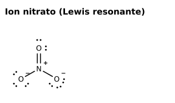
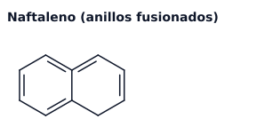
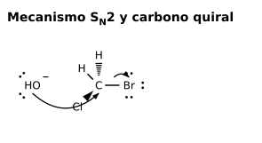

[Manual](../../README.md) › [Química](../README.md) › [Estructura y enlace](README.md)

# Molécula (`molecule`)

Dibuja una molécula a partir de sus átomos y enlaces: en fórmula de Lewis (con pares libres,
cargas y radicales) o esqueletal (sin carbonos ni hidrógenos explícitos). Los átomos se ubican
por coordenadas o encadenados por ángulo desde otro; los anillos se arman solos y dos que
comparten vértices se fusionan. Las flechas curvas muestran un mecanismo.

## Campos

| Campo | Tipo | Valores y valor por defecto | Descripción |
| :--- | :--- | :--- | :--- |
| `type` | texto | `molecule` | Obligatorio. |
| `atoms` | lista |  | Los átomos: `id`, `el` (el símbolo, también grupos como `OH`), `at: [x, y]` en largos de enlace, o `from` y `angle` (con `length` y `bond`, el orden del enlace con ese átomo); `charge`, `lonePairs`, `radical`, `note` (como δ+), `show`, `blank`. |
| `rings` | lista |  | Anillos: `size`, `center`, `start`, `ids` (los ids de sus vértices), `aromatic` (con círculo) o `kekule` (dobles alternados). |
| `bonds` | lista |  | Enlaces extra: `[a, b, orden]` o `{from, to, order, stereo, dashed, blank}`. El orden es 1, 2, 3, 1.5 o 0.5; `stereo` es `wedge` (cuña) o `hash` (rayas). |
| `arrows` | lista |  | Flechas curvas de mecanismo: `from` y `to` (un átomo o un enlace `[a, b]`), `bend` (la curvatura) y `half` (un solo electrón). |
| `skeletal` | sí/no |  | Fórmula esqueletal. |
| `bondLength` | número |  | El largo de un enlace, en píxeles. |
| `caption` | texto |  | Un rótulo debajo de la molécula. |

Además, los campos comunes a todos los tipos: `title`, `subtitle`, `id`, `inkSaver` y `theme` (ver [Campos comunes](../../campos-comunes.md)).

## Ejemplos

### Ion nitrato (Lewis resonante)

```yaml
type: molecule
title: Ion nitrato (Lewis resonante)
atoms:
  - {id: n, el: N, at: [0, 0], charge: 1}
  - {id: o1, el: O, from: n, angle: 90, bond: 2, lonePairs: 2}
  - {id: o2, el: O, from: n, angle: 210, lonePairs: 3, charge: -1}
  - {id: o3, el: O, from: n, angle: 330, lonePairs: 3, charge: -1}
```

[](https://ingcom-unrn.github.io/dibu-web/#z=fY7BCsIwEETv_Yo5KqTQNifzB4Kod_EQ61oD6a4kERHx3416qD3U4yzvzU66X8igF0_t1VORXPI5L4XBLgWbBLMV3VxEoChsOdG8yNc-mgIo8XBHA1Ygb7BWsMlgVylUe4X2bEOXu-rnQEr9RTcKpyD9R7XcvV8usnYQzlCj4IVpa12IOf3qzaTe1NVI08OAcrRAT1Zo_bfiBQ)

[Abrir en el editor](https://ingcom-unrn.github.io/dibu-web/#z=fY7BCsIwEETv_Yo5KqTQNifzB4Kod_EQ61oD6a4kERHx3416qD3U4yzvzU66X8igF0_t1VORXPI5L4XBLgWbBLMV3VxEoChsOdG8yNc-mgIo8XBHA1Ygb7BWsMlgVylUe4X2bEOXu-rnQEr9RTcKpyD9R7XcvV8usnYQzlCj4IVpa12IOf3qzaTe1NVI08OAcrRAT1Zo_bfiBQ) para explorarlo y modificarlo.

### Naftaleno (anillos fusionados)

```yaml
type: molecule
title: Naftaleno (anillos fusionados)
skeletal: true
rings:
  - {size: 6, center: [0, 0], start: 30, kekule: true}
  - {size: 6, center: [1.732, 0], start: 30}
bonds:
  - [r1_1, r1_2, 2]
  - [r1_5, r1_0, 2]
inkSaver: false
```

[](https://ingcom-unrn.github.io/dibu-web/#z=dY3LCsIwEEX3-YpZKkTpAxXyEW5cliKxTiV0TCQzEVT676ZFXAhuBu7hnrnyuKGBayDsEqESJ5Tz3vZiCX2AhfWOKDD0iV3w9hx4qXhAwlwwIDGhis5f2CiAFbzYPbO_1dChF4wGmkJD0WpgsVEM1DkOOKRpZZLHf1q53tXVjzqqU_Dnz1QTy2OpId9cq9ov28ysmJnzw8Hep3-9JUb1Bg)

[Abrir en el editor](https://ingcom-unrn.github.io/dibu-web/#z=dY3LCsIwEEX3-YpZKkTpAxXyEW5cliKxTiV0TCQzEVT676ZFXAhuBu7hnrnyuKGBayDsEqESJ5Tz3vZiCX2AhfWOKDD0iV3w9hx4qXhAwlwwIDGhis5f2CiAFbzYPbO_1dChF4wGmkJD0WpgsVEM1DkOOKRpZZLHf1q53tXVjzqqU_Dnz1QTy2OpId9cq9ov28ysmJnzw8Hep3-9JUb1Bg) para explorarlo y modificarlo.

### Mecanismo S_N\2 y carbono quiral

```yaml
type: molecule
title: "Mecanismo S_N\\2 y carbono quiral"
atoms:
  - {id: oh, el: HO, at: [-2.2, 0], charge: -1, lonePairs: 2}
  - {id: c, el: C, at: [0, 0]}
  - {id: br, el: Br, from: c, angle: 0, lonePairs: 3}
  - {id: h1, el: H, from: c, angle: 90, bond: {stereo: hash}}
  - {id: cl, el: Cl, from: c, angle: 225, bond: {stereo: wedge}}
  - {id: h3, el: H, from: c, angle: 135, length: 0.8}
arrows:
  - {from: oh, to: c, bend: 1}
  - {from: [c, br], to: br, bend: -1}
```

[](https://ingcom-unrn.github.io/dibu-web/#z=dZBBa8MwDIXv-RWiZ6ckDoPNx-2yy7rBjm0ZTqrFAcfqbJdSiv_77CZjHmEnI7_3SU_ylyMKGEljd9JY-MHrWK9esJNmcCPB-8dmt-NwgU7algzB12mwUq8K6Wl0ogAo4TocBJBigFrA8ysD6QVsS77mDKo9g05J28e2Zc1Ak8E3OVgngIdfupvgp5mtEpjJrZ30x_h-WhpvgDR9Clv9adpklKrnSEvoIVJxnWi6Oo8WKbqlUyGPpOdMeolzfrfgz3joMW-gmn_H103kNZreq7jA-j4U0lo6_9xzsqeLerphLaZRdcjlbfq3-8mTDjSZyjoU3w)

[Abrir en el editor](https://ingcom-unrn.github.io/dibu-web/#z=dZBBa8MwDIXv-RWiZ6ckDoPNx-2yy7rBjm0ZTqrFAcfqbJdSiv_77CZjHmEnI7_3SU_ylyMKGEljd9JY-MHrWK9esJNmcCPB-8dmt-NwgU7algzB12mwUq8K6Wl0ogAo4TocBJBigFrA8ysD6QVsS77mDKo9g05J28e2Zc1Ak8E3OVgngIdfupvgp5mtEpjJrZ30x_h-WhpvgDR9Clv9adpklKrnSEvoIVJxnWi6Oo8WKbqlUyGPpOdMeolzfrfgz3joMW-gmn_H103kNZreq7jA-j4U0lo6_9xzsqeLerphLaZRdcjlbfq3-8mTDjSZyjoU3w) para explorarlo y modificarlo.

## Ver también

[`vsepr`](vsepr.md), [`orbitals`](orbitals.md), [`unit_cell`](unit_cell.md)
