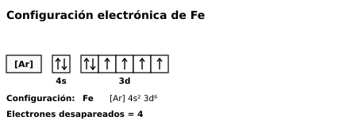
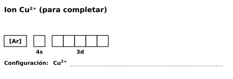
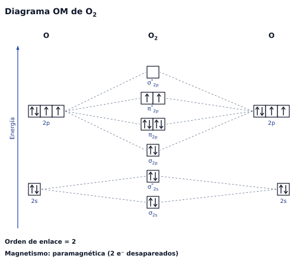
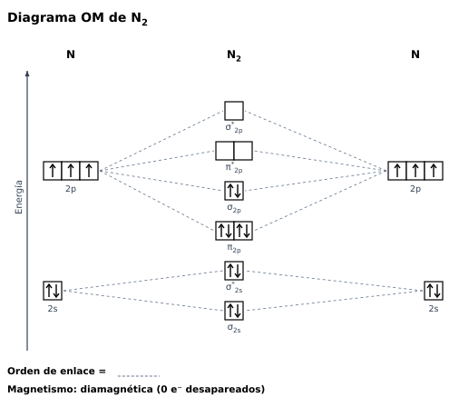

[Manual](../../README.md) › [Química](../README.md) › [Estructura y enlace](README.md)

# Orbitales (`orbitals`)

En la variante atómica dibuja los casilleros de la configuración electrónica de un elemento o
ion, con la configuración abreviada y los electrones desapareados. En la molecular, el diagrama
de orbitales moleculares de una molécula diatómica del segundo período, con el orden de enlace
y el magnetismo.

## Qué calcula

- La configuración electrónica, con las excepciones del Cr y el Cu y los cationes de transición.
- El llenado de los orbitales moleculares, con o sin mezcla s-p, el orden de enlace y el magnetismo.

## Campos

| Campo | Tipo | Valores y valor por defecto | Descripción |
| :--- | :--- | :--- | :--- |
| `type` | texto | `orbitals` | Obligatorio. |
| `kind` | texto |  | `atomic` (por omisión) o `molecular`. |
| `element` | texto |  | En `atomic`, el elemento. |
| `charge` | número |  | La carga del ion. |
| `core` | sí/no |  | En `atomic`, abrevia con el gas noble (`[Ar]`) y dibuja sólo la capa de valencia. |
| `showConfig` | sí/no |  | Escribe la configuración. |
| `showUnpaired` | sí/no |  | Escribe los electrones desapareados. |
| `atoms` | lista |  | En `molecular`, los dos átomos (`[O, O]`, `[C, O]`; de H a Ne). |
| `maxWidth` | número |  | El ancho máximo, en píxeles. |
| `blank` | sí/no |  | Deja los casilleros vacíos. |
| `blankConfig` | sí/no |  | Deja la configuración en blanco. |
| `blankUnpaired` | sí/no |  | Deja en blanco los desapareados. |
| `blankElectrons` | sí/no |  | En `molecular`, deja los orbitales vacíos. |
| `blankBondOrder` | sí/no |  | En `molecular`, deja el orden de enlace en blanco. |
| `blankMagnetism` | sí/no |  | En `molecular`, deja el magnetismo en blanco. |

Además, los campos comunes a todos los tipos: `title`, `subtitle`, `id`, `inkSaver` y `theme` (ver [Campos comunes](../../campos-comunes.md)).

## Modo ejercicio

Campos que dejan casilleros para completar: `blank`, `blankConfig`, `blankUnpaired`, `blankElectrons`, `blankBondOrder`, `blankMagnetism`.

## Ejemplos

### Configuración electrónica de Fe

```yaml
type: orbitals
title: Configuración electrónica de Fe
element: Fe
core: true
showUnpaired: true
```



### Ion Cu²⁺ (para completar)

```yaml
type: orbitals
title: Ion Cu²⁺ (para completar)
element: Cu
charge: 2
core: true
blank: true
```



### Diagrama OM de O2

```yaml
type: orbitals
kind: molecular
title: Diagrama OM de O2
atoms: [O, O]
inkSaver: false
```



### Diagrama OM de N2

```yaml
type: orbitals
kind: molecular
title: Diagrama OM de N2
atoms: [N, N]
blankBondOrder: true
```



## Ver también

[`molecule`](molecule.md), [`vsepr`](vsepr.md), [`unit_cell`](unit_cell.md)
