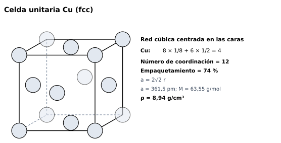
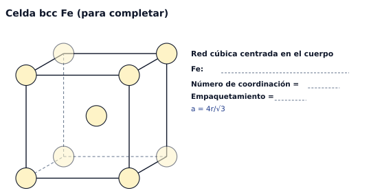

[Manual](../../README.md) › [Química](../README.md) › [Estructura y enlace](README.md)

# Celda unidad (`unit_cell`)

Dibuja una celda unidad cúbica en perspectiva y calcula sus propiedades: la cantidad de
átomos por celda, el número de coordinación, la fracción de empaquetamiento y, con el lado y
la masa molar, la densidad.

## Qué calcula

- Z, la coordinación y la fracción de empaquetamiento de cada red.
- La densidad ρ = Z·M / (N_A·a³).

## Campos

| Campo | Tipo | Valores y valor por defecto | Descripción |
| :--- | :--- | :--- | :--- |
| `type` | texto | `unit_cell` | Obligatorio. |
| `lattice` | texto |  | `sc`, `bcc`, `fcc`, `nacl` o `cscl`. |
| `element` | texto |  | El elemento (en las redes de un solo tipo de átomo). |
| `species` | lista |  | Las especies de una red iónica. |
| `a` | número |  | El lado de la celda, en pm. |
| `molarMass` | número |  | La masa molar, en g/mol (para la densidad). |
| `blank` | sí/no |  | `true` o una lista de `z`, `coordination`, `packing` y `density`. |

Además, los campos comunes a todos los tipos: `title`, `subtitle`, `id`, `inkSaver` y `theme` (ver [Campos comunes](../../campos-comunes.md)).

## Modo ejercicio

Campos que dejan casilleros para completar: `blank`.

## Ejemplos

### Celda unitaria Cu (fcc)

```yaml
type: unit_cell
title: Celda unitaria Cu (fcc)
lattice: fcc
element: Cu
a: 361.5
molarMass: 63.55
```



### Celda bcc Fe (para completar)

```yaml
type: unit_cell
title: Celda bcc Fe (para completar)
lattice: bcc
element: Fe
blank: true
inkSaver: false
```



## Ver también

[`molecule`](molecule.md), [`vsepr`](vsepr.md), [`orbitals`](orbitals.md)
