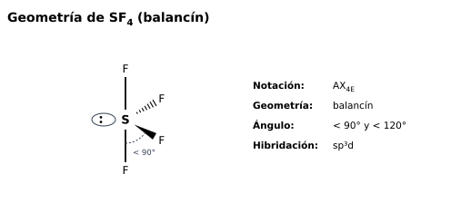
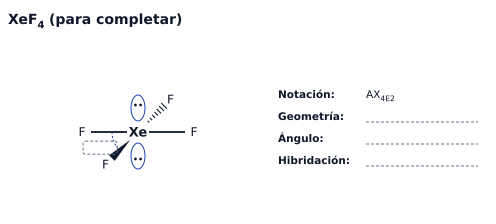

[Manual](../../README.md) › [Química](../README.md) › [Estructura y enlace](README.md)

# Geometría molecular (TRePEV) (`vsepr`)

Dibuja la geometría molecular según la teoría de repulsión de pares electrónicos de valencia,
con el átomo central, los ligandos y los pares libres. La geometría sale de la cantidad de
pares, o se fija con `geometry`. Debajo, la notación AXE, el nombre de la geometría, el ángulo
y la hibridación.

## Qué calcula

- La geometría, la notación AXE, el ángulo de enlace y la hibridación a partir de los pares.

## Campos

| Campo | Tipo | Valores y valor por defecto | Descripción |
| :--- | :--- | :--- | :--- |
| `type` | texto | `vsepr` | Obligatorio. |
| `central` | texto |  | El átomo central. |
| `ligands` | lista |  | Los ligandos. |
| `lonePairs` | número |  | Los pares libres sobre el átomo central. |
| `geometry` | texto |  | La geometría, si no sale de los pares: `linear`, `trigonal_planar`, `bent_trigonal`, `tetrahedral`, `trigonal_pyramidal`, `bent`, `trigonal_bipyramidal`, `seesaw`, `t_shaped`, `linear_tbp`, `octahedral`, `square_pyramidal`, `square_planar`. |
| `showAngle` | sí/no |  | Escribe el ángulo. |
| `showHybridization` | sí/no |  | Escribe la hibridación. |
| `blank` | lista |  | `true` o una lista de `axe`, `name`, `angle` y `hybridization` para dejar en blanco. |

Además, los campos comunes a todos los tipos: `title`, `subtitle`, `id`, `inkSaver` y `theme` (ver [Campos comunes](../../campos-comunes.md)).

## Modo ejercicio

Campos que dejan casilleros para completar: `blank`.

## Ejemplos

### Geometría de SF4 (balancín)

```yaml
type: vsepr
title: Geometría de SF4 (balancín)
central: S
ligands: [F, F, F, F]
lonePairs: 1
```

[](https://ingcom-unrn.github.io/dibu-web/#t=dHlwZTogdnNlcHIKdGl0bGU6IEdlb21ldHLDrWEgZGUgU0Y0IChiYWxhbmPDrW4pCmNlbnRyYWw6IFMKbGlnYW5kczogW0YsIEYsIEYsIEZdCmxvbmVQYWlyczogMQo)

[Abrir en el editor](https://ingcom-unrn.github.io/dibu-web/#t=dHlwZTogdnNlcHIKdGl0bGU6IEdlb21ldHLDrWEgZGUgU0Y0IChiYWxhbmPDrW4pCmNlbnRyYWw6IFMKbGlnYW5kczogW0YsIEYsIEYsIEZdCmxvbmVQYWlyczogMQo) para explorarlo y modificarlo.

### XeF4 (para completar)

```yaml
type: vsepr
title: XeF4 (para completar)
central: Xe
ligands: [F, F, F, F]
lonePairs: 2
blank: [name, angle, hybridization]
inkSaver: false
```

[](https://ingcom-unrn.github.io/dibu-web/#t=dHlwZTogdnNlcHIKdGl0bGU6IFhlRjQgKHBhcmEgY29tcGxldGFyKQpjZW50cmFsOiBYZQpsaWdhbmRzOiBbRiwgRiwgRiwgRl0KbG9uZVBhaXJzOiAyCmJsYW5rOiBbbmFtZSwgYW5nbGUsIGh5YnJpZGl6YXRpb25dCmlua1NhdmVyOiBmYWxzZQo)

[Abrir en el editor](https://ingcom-unrn.github.io/dibu-web/#t=dHlwZTogdnNlcHIKdGl0bGU6IFhlRjQgKHBhcmEgY29tcGxldGFyKQpjZW50cmFsOiBYZQpsaWdhbmRzOiBbRiwgRiwgRiwgRl0KbG9uZVBhaXJzOiAyCmJsYW5rOiBbbmFtZSwgYW5nbGUsIGh5YnJpZGl6YXRpb25dCmlua1NhdmVyOiBmYWxzZQo) para explorarlo y modificarlo.

## Ver también

[`molecule`](molecule.md), [`orbitals`](orbitals.md), [`unit_cell`](unit_cell.md)
