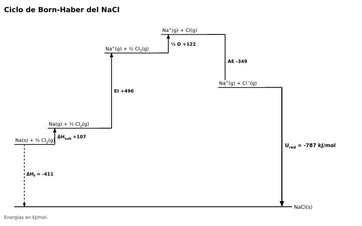
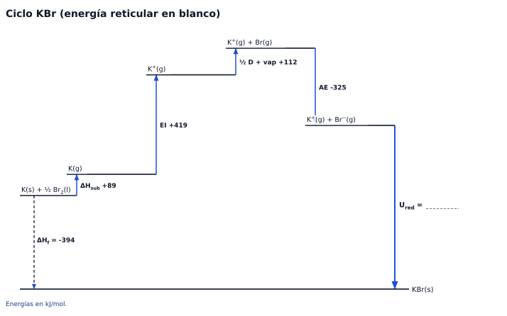

[Manual](../../README.md) › [Química](../README.md) › [Química inorgánica](README.md)

# Ciclo de Born-Haber (`born_haber`)

Dibuja el ciclo de Born-Haber como un diagrama de niveles: desde los elementos, cada paso
hasta los iones gaseosos y la formación del sólido, y calcula la energía de red por la ley de
Hess.

## Qué calcula

- La energía de red, como la diferencia entre ΔHf y la suma de los pasos.

## Campos

| Campo | Tipo | Valores y valor por defecto | Descripción |
| :--- | :--- | :--- | :--- |
| `type` | texto | `born_haber` | Obligatorio. |
| `start` | texto |  | El estado inicial (los elementos). |
| `steps` | lista |  | Los pasos hasta los iones gaseosos: `to`, `dH`, `label` y `blank`. |
| `formation` | número |  | La entalpía de formación ΔHf. |
| `product` | texto |  | El sólido. |
| `blankLattice` | sí/no |  | Deja la energía de red en blanco. |

Además, los campos comunes a todos los tipos: `title`, `subtitle`, `id`, `inkSaver` y `theme` (ver [Campos comunes](../../campos-comunes.md)).

## Modo ejercicio

Campos que dejan casilleros para completar: `blankLattice`.

## Ejemplos

### Ciclo de Born-Haber del NaCl

```yaml
type: born_haber
title: Ciclo de Born-Haber del NaCl
start: "Na(s) + ½ Cl2(g)"
product: "NaCl(s)"
formation: -411
steps:
  - {to: "Na(g) + ½ Cl2(g)", dH: 107, label: "ΔH_sub"}
  - {to: "Na^+(g) + ½ Cl2(g)", dH: 496, label: "EI"}
  - {to: "Na^+(g) + Cl(g)", dH: 122, label: "½ D"}
  - {to: "Na^+(g) + Cl^-(g)", dH: -349, label: "AE"}
```

[](https://ingcom-unrn.github.io/dibu-web/#t=dHlwZTogYm9ybl9oYWJlcgp0aXRsZTogQ2ljbG8gZGUgQm9ybi1IYWJlciBkZWwgTmFDbApzdGFydDogIk5hKHMpICsgwr0gQ2wyKGcpIgpwcm9kdWN0OiAiTmFDbChzKSIKZm9ybWF0aW9uOiAtNDExCnN0ZXBzOgogIC0ge3RvOiAiTmEoZykgKyDCvSBDbDIoZykiLCBkSDogMTA3LCBsYWJlbDogIs6USF9zdWIifQogIC0ge3RvOiAiTmFeKyhnKSArIMK9IENsMihnKSIsIGRIOiA0OTYsIGxhYmVsOiAiRUkifQogIC0ge3RvOiAiTmFeKyhnKSArIENsKGcpIiwgZEg6IDEyMiwgbGFiZWw6ICLCvSBEIn0KICAtIHt0bzogIk5hXisoZykgKyBDbF4tKGcpIiwgZEg6IC0zNDksIGxhYmVsOiAiQUUifQo)

[Abrir en el editor](https://ingcom-unrn.github.io/dibu-web/#t=dHlwZTogYm9ybl9oYWJlcgp0aXRsZTogQ2ljbG8gZGUgQm9ybi1IYWJlciBkZWwgTmFDbApzdGFydDogIk5hKHMpICsgwr0gQ2wyKGcpIgpwcm9kdWN0OiAiTmFDbChzKSIKZm9ybWF0aW9uOiAtNDExCnN0ZXBzOgogIC0ge3RvOiAiTmEoZykgKyDCvSBDbDIoZykiLCBkSDogMTA3LCBsYWJlbDogIs6USF9zdWIifQogIC0ge3RvOiAiTmFeKyhnKSArIMK9IENsMihnKSIsIGRIOiA0OTYsIGxhYmVsOiAiRUkifQogIC0ge3RvOiAiTmFeKyhnKSArIENsKGcpIiwgZEg6IDEyMiwgbGFiZWw6ICLCvSBEIn0KICAtIHt0bzogIk5hXisoZykgKyBDbF4tKGcpIiwgZEg6IC0zNDksIGxhYmVsOiAiQUUifQo) para explorarlo y modificarlo.

### Ciclo KBr (energía reticular en blanco)

```yaml
type: born_haber
title: Ciclo KBr (energía reticular en blanco)
start: "K(s) + ½ Br2(l)"
product: "KBr(s)"
formation: -394
steps:
  - {to: "K(g)", dH: 89, label: "ΔH_sub"}
  - {to: "K^+(g)", dH: 419, label: "EI"}
  - {to: "K^+(g) + Br(g)", dH: 112, label: "½ D + vap"}
  - {to: "K^+(g) + Br^-(g)", dH: -325, label: "AE"}
blankLattice: true
inkSaver: false
```

[](https://ingcom-unrn.github.io/dibu-web/#t=dHlwZTogYm9ybl9oYWJlcgp0aXRsZTogQ2ljbG8gS0JyIChlbmVyZ8OtYSByZXRpY3VsYXIgZW4gYmxhbmNvKQpzdGFydDogIksocykgKyDCvSBCcjIobCkiCnByb2R1Y3Q6ICJLQnIocykiCmZvcm1hdGlvbjogLTM5NApzdGVwczoKICAtIHt0bzogIksoZykiLCBkSDogODksIGxhYmVsOiAizpRIX3N1YiJ9CiAgLSB7dG86ICJLXisoZykiLCBkSDogNDE5LCBsYWJlbDogIkVJIn0KICAtIHt0bzogIkteKyhnKSArIEJyKGcpIiwgZEg6IDExMiwgbGFiZWw6ICLCvSBEICsgdmFwIn0KICAtIHt0bzogIkteKyhnKSArIEJyXi0oZykiLCBkSDogLTMyNSwgbGFiZWw6ICJBRSJ9CmJsYW5rTGF0dGljZTogdHJ1ZQppbmtTYXZlcjogZmFsc2UK)

[Abrir en el editor](https://ingcom-unrn.github.io/dibu-web/#t=dHlwZTogYm9ybl9oYWJlcgp0aXRsZTogQ2ljbG8gS0JyIChlbmVyZ8OtYSByZXRpY3VsYXIgZW4gYmxhbmNvKQpzdGFydDogIksocykgKyDCvSBCcjIobCkiCnByb2R1Y3Q6ICJLQnIocykiCmZvcm1hdGlvbjogLTM5NApzdGVwczoKICAtIHt0bzogIksoZykiLCBkSDogODksIGxhYmVsOiAizpRIX3N1YiJ9CiAgLSB7dG86ICJLXisoZykiLCBkSDogNDE5LCBsYWJlbDogIkVJIn0KICAtIHt0bzogIkteKyhnKSArIEJyKGcpIiwgZEg6IDExMiwgbGFiZWw6ICLCvSBEICsgdmFwIn0KICAtIHt0bzogIkteKyhnKSArIEJyXi0oZykiLCBkSDogLTMyNSwgbGFiZWw6ICJBRSJ9CmJsYW5rTGF0dGljZTogdHJ1ZQppbmtTYXZlcjogZmFsc2UK) para explorarlo y modificarlo.

## Ver también

[`crystal_field`](crystal_field.md), [`complex`](complex.md)
