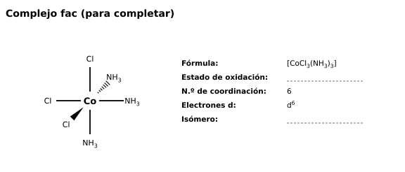

[Manual](../../README.md) › [Química](../README.md) › [Química inorgánica](README.md)

# Complejo de coordinación (`complex`)

Dibuja un complejo de coordinación octaédrico, tetraédrico o cuadrado plano con sus ligandos
en su lugar, y calcula la fórmula, el estado de oxidación del metal, la coordinación, los
electrones d y el isómero (cis/trans, fac/mer).

## Qué calcula

- La fórmula y el estado de oxidación a partir de las cargas de los ligandos.
- El isómero geométrico.

## Campos

| Campo | Tipo | Valores y valor por defecto | Descripción |
| :--- | :--- | :--- | :--- |
| `type` | texto | `complex` | Obligatorio. |
| `geometry` | texto |  | `octahedral`, `tetrahedral` o `square_planar`. |
| `metal` | texto |  | El metal. |
| `ligands` | lista |  | Los ligandos, en orden: arriba, abajo, izquierda, derecha, adelante, atrás (en el cuadrado plano: izquierda, derecha, adelante, atrás). |
| `charge` | número |  | La carga del complejo. |
| `oxidation` | número |  | El estado de oxidación, si un ligando no es de la tabla. |
| `blank` | lista |  | `true` o una lista de `formula`, `oxidation`, `coordination`, `d` e `isomer`. |

Además, los campos comunes a todos los tipos: `title`, `subtitle`, `id`, `inkSaver` y `theme` (ver [Campos comunes](../../campos-comunes.md)).

## Modo ejercicio

Campos que dejan casilleros para completar: `blank`.

## Ejemplos

### trans-[Co(NH3)4Cl2]^+

```yaml
type: complex
title: "trans-[Co(NH3)4Cl2]^+"
metal: Co
charge: 1
ligands: [NH3, NH3, Cl, Cl, NH3, NH3]
inkSaver: false
```

![trans-[Co(NH3)4Cl2]^+](img/ks_chem_complex_trans.svg)

### Complejo fac (para completar)

```yaml
type: complex
title: Complejo fac (para completar)
metal: Co
ligands: [Cl, NH3, Cl, NH3, Cl, NH3]
blank: [isomer, oxidation]
```



## Ver también

[`crystal_field`](crystal_field.md), [`born_haber`](born_haber.md)
