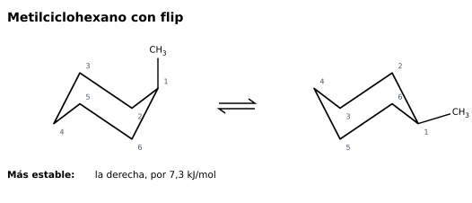
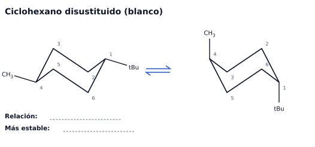

[Manual](../../README.md) › [Química](../README.md) › [Química orgánica](README.md)

# Silla del ciclohexano (`chair`)

Dibuja la silla del ciclohexano con sus sustituyentes axiales y ecuatoriales y, con `flip`,
también la silla invertida. Dice si los sustituyentes son cis o trans y, con los valores A
conocidos, cuál silla es más estable y por cuánta energía.

## Qué calcula

- La relación cis/trans y la diferencia de energía entre las sillas por valores A (CH₃ 7,3 kJ/mol, tBu 21…).

## Campos

| Campo | Tipo | Valores y valor por defecto | Descripción |
| :--- | :--- | :--- | :--- |
| `type` | texto | `chair` | Obligatorio. |
| `substituents` | lista |  | Los sustituyentes: `position` (1 a 6), `group`, `axial` y `blank`. |
| `flip` | sí/no |  | Dibuja también la silla invertida (los axiales pasan a ecuatoriales). |
| `showRelation` | sí/no |  | Escribe si es cis o trans (por omisión, sí). |
| `showStability` | sí/no |  | Escribe cuál silla es más estable. |
| `blank` | sí/no |  | Deja los sustituyentes en blanco. |
| `blankRelation` | sí/no |  | Deja en blanco la relación cis/trans. |
| `blankStability` | sí/no |  | Deja en blanco la estabilidad. |

Además, los campos comunes a todos los tipos: `title`, `subtitle`, `id`, `inkSaver` y `theme` (ver [Campos comunes](../../campos-comunes.md)).

## Modo ejercicio

Campos que dejan casilleros para completar: `blank`, `blankRelation`, `blankStability`.

## Ejemplos

### Metilciclohexano con flip

```yaml
type: chair
title: Metilciclohexano con flip
substituents:
  - {position: 1, group: CH3, axial: true}
flip: true
```

[](https://ingcom-unrn.github.io/dibu-web/#z=JYsxCsMwDEV3neIfIB1KN61duvQQrlESgbCMLUNC6N2T0u09eC_2Koy8Jm0UGnbJW0ItazZfZUvFkb1gNq3Ux6df0ZASnQm44ajeNdQL4z5haT4q4_l6TEibJmNEG_Kl3_1nOgE)

[Abrir en el editor](https://ingcom-unrn.github.io/dibu-web/#z=JYsxCsMwDEV3neIfIB1KN61duvQQrlESgbCMLUNC6N2T0u09eC_2Koy8Jm0UGnbJW0ItazZfZUvFkb1gNq3Ux6df0ZASnQm44ajeNdQL4z5haT4q4_l6TEibJmNEG_Kl3_1nOgE) para explorarlo y modificarlo.

### Ciclohexano disustituido (blanco)

```yaml
type: chair
title: Ciclohexano disustituido (blanco)
substituents:
  - {position: 1, group: tBu, axial: false}
  - {position: 4, group: CH3, axial: false}
flip: true
blank: true
inkSaver: false
```

[](https://ingcom-unrn.github.io/dibu-web/#z=XY2xDsIwDET3fIVHkMqAYMpIF3a-wG1TatWKo8SuihD_Tosqhm53T093-krBQzsgZaekvJSaWpYhzBgFOipWFm7UCRwaxtjK0RVrfjBELd4BnOCdpJCSRA_nCp5ZLHnQm1WAMyF76JFL-Ozd69-t75e92zOtI9mCW4_HLVMcHziFvHnuCw)

[Abrir en el editor](https://ingcom-unrn.github.io/dibu-web/#z=XY2xDsIwDET3fIVHkMqAYMpIF3a-wG1TatWKo8SuihD_Tosqhm53T093-krBQzsgZaekvJSaWpYhzBgFOipWFm7UCRwaxtjK0RVrfjBELd4BnOCdpJCSRA_nCp5ZLHnQm1WAMyF76JFL-Ozd69-t75e92zOtI9mCW4_HLVMcHziFvHnuCw) para explorarlo y modificarlo.

## Ver también

[`newman`](newman.md), [`fischer`](fischer.md)
