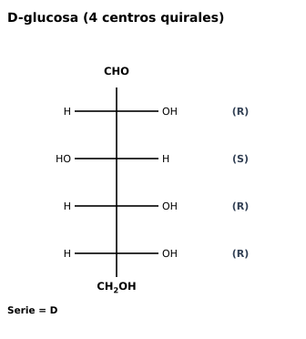
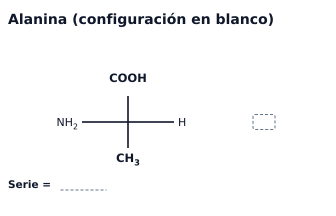

[Manual](../../README.md) › [Química](../README.md) › [Química orgánica](README.md)

# Proyección de Fischer (`fischer`)

Dibuja la proyección de Fischer de una molécula con uno o varios centros quirales, de arriba
hacia abajo. Con un solo centro asigna R o S por las reglas CIP para los grupos comunes; la
serie D o L sale del último centro.

## Qué calcula

- R/S con prioridades CIP (OH, NH₂, CHO, COOH, CH₂OH, CH₃, halógenos…), o con `priorities`.
- La serie D/L.

## Campos

| Campo | Tipo | Valores y valor por defecto | Descripción |
| :--- | :--- | :--- | :--- |
| `type` | texto | `fischer` | Obligatorio. |
| `top` | texto |  | El grupo de arriba. |
| `bottom` | texto |  | El grupo de abajo. |
| `centers` | lista |  | Los centros, de arriba hacia abajo: `left`, `right`, `blank` (`left`, `right` o `true`) y `priorities` (los lugares `top`, `right`, `bottom`, `left` de mayor a menor prioridad). |
| `showConfig` | sí/no |  | Escribe R o S. |
| `showSeries` | sí/no |  | Escribe la serie D o L (por omisión, sí). |
| `blank` | sí/no |  | Deja los grupos en blanco. |
| `blankConfig` | sí/no |  | Deja R/S en blanco. |
| `blankSeries` | sí/no |  | Deja la serie en blanco. |

Además, los campos comunes a todos los tipos: `title`, `subtitle`, `id`, `inkSaver` y `theme` (ver [Campos comunes](../../campos-comunes.md)).

## Modo ejercicio

Campos que dejan casilleros para completar: `blank`, `blankConfig`, `blankSeries`.

## Ejemplos

### D-glucosa (4 centros quirales)

```yaml
type: fischer
title: D-glucosa (4 centros quirales)
top: CHO
bottom: CH2OH
centers:
  - {left: H, right: OH, priorities: [right, top, bottom, left]}
  - {left: HO, right: H, priorities: [left, top, bottom, right]}
  - {left: H, right: OH, priorities: [right, top, bottom, left]}
  - {left: H, right: OH, priorities: [right, top, bottom, left]}
```

[](https://ingcom-unrn.github.io/dibu-web/#z=pc4xDsIwDAXQPaf4I0jpgpiywtAtB0AMpXJbS4EUxx0qxN1JioRER9i-re8n6zySQ8epHUiMsoY8Hqs-TG1MDTZ7tHRTiQn3iaUJlLZG4-hwqL25RNV4LXnna1OKJMkZoMIjUKcOtYVwP-TkcxyFo7AyJYfTsrfImMUbsihH5-cX4D_CGiiF1f3SXAF_f_AT8AI)

[Abrir en el editor](https://ingcom-unrn.github.io/dibu-web/#z=pc4xDsIwDAXQPaf4I0jpgpiywtAtB0AMpXJbS4EUxx0qxN1JioRER9i-re8n6zySQ8epHUiMsoY8Hqs-TG1MDTZ7tHRTiQn3iaUJlLZG4-hwqL25RNV4LXnna1OKJMkZoMIjUKcOtYVwP-TkcxyFo7AyJYfTsrfImMUbsihH5-cX4D_CGiiF1f3SXAF_f_AT8AI) para explorarlo y modificarlo.

### Alanina (configuración en blanco)

```yaml
type: fischer
title: Alanina (configuración en blanco)
top: COOH
bottom: CH3
centers:
  - {left: NH2, right: H}
blankConfig: true
blankSeries: true
inkSaver: false
```

[](https://ingcom-unrn.github.io/dibu-web/#z=LY47DgIxDER7n8IlSNBAlw5tk4otOEE2cnYtgrNyvEgIcSqOwMUIn27ejPQ0dpvJYeIaJ1IwttzwkIOwBFzFIonHRUPk11OQBIc2xbIGK7PDru89DMWsXBr4PUQSI60OELd4z5TM4dHvNqg8Ti37B3wE5-7rdWi60K85kTLVf8ONw5W0HQu5ErwB)

[Abrir en el editor](https://ingcom-unrn.github.io/dibu-web/#z=LY47DgIxDER7n8IlSNBAlw5tk4otOEE2cnYtgrNyvEgIcSqOwMUIn27ejPQ0dpvJYeIaJ1IwttzwkIOwBFzFIonHRUPk11OQBIc2xbIGK7PDru89DMWsXBr4PUQSI60OELd4z5TM4dHvNqg8Ti37B3wE5-7rdWi60K85kTLVf8ONw5W0HQu5ErwB) para explorarlo y modificarlo.

## Ver también

[`newman`](newman.md), [`chair`](chair.md)
