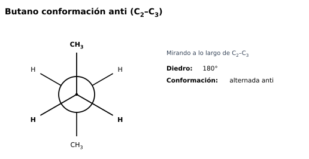

[Manual](../../README.md) › [Química](../README.md) › [Química orgánica](README.md)

# Proyección de Newman (`newman`)

Dibuja la proyección de Newman de un enlace: los tres sustituyentes del carbono de adelante y
los del de atrás, girados según el diedro. Nombra la conformación (anti, gauche, eclipsada).

## Campos

| Campo | Tipo | Valores y valor por defecto | Descripción |
| :--- | :--- | :--- | :--- |
| `type` | texto | `newman` | Obligatorio. |
| `front` | lista |  | Los tres sustituyentes del carbono de adelante. |
| `back` | lista |  | Los tres del de atrás. |
| `dihedral` | número |  | El diedro entre el primero de adelante y el primero de atrás: 180 anti, 60 gauche, 0 eclipsada. |
| `start` | texto |  | El ángulo del primer sustituyente de adelante. |
| `axis` | texto |  | El rótulo del enlace (`C2–C3`). |
| `blank` | sí/no |  | Deja los sustituyentes en blanco. |
| `blankName` | sí/no |  | Deja en blanco el nombre de la conformación. |
| `blankDihedral` | sí/no |  | Deja el diedro en blanco. |

Además, los campos comunes a todos los tipos: `title`, `subtitle`, `id`, `inkSaver` y `theme` (ver [Campos comunes](../../campos-comunes.md)).

## Modo ejercicio

Campos que dejan casilleros para completar: `blank`, `blankName`, `blankDihedral`.

## Ejemplos

### Butano conformación anti (C2–C3)

```yaml
type: newman
title: Butano conformación anti (C2–C3)
axis: C2–C3
front: [CH3, H, H]
back: [CH3, H, H]
dihedral: 180
```

[](https://ingcom-unrn.github.io/dibu-web/#t=dHlwZTogbmV3bWFuCnRpdGxlOiBCdXRhbm8gY29uZm9ybWFjacOzbiBhbnRpIChDMuKAk0MzKQpheGlzOiBDMuKAk0MzCmZyb250OiBbQ0gzLCBILCBIXQpiYWNrOiBbQ0gzLCBILCBIXQpkaWhlZHJhbDogMTgwCg)

[Abrir en el editor](https://ingcom-unrn.github.io/dibu-web/#t=dHlwZTogbmV3bWFuCnRpdGxlOiBCdXRhbm8gY29uZm9ybWFjacOzbiBhbnRpIChDMuKAk0MzKQpheGlzOiBDMuKAk0MzCmZyb250OiBbQ0gzLCBILCBIXQpiYWNrOiBbQ0gzLCBILCBIXQpkaWhlZHJhbDogMTgwCg) para explorarlo y modificarlo.

### Conformación gauche (en blanco)

```yaml
type: newman
title: Conformación gauche (en blanco)
front: [CH3, H, H]
back: [CH3, H, H]
dihedral: 60
blankName: true
inkSaver: false
```

[](https://ingcom-unrn.github.io/dibu-web/#t=dHlwZTogbmV3bWFuCnRpdGxlOiBDb25mb3JtYWNpw7NuIGdhdWNoZSAoZW4gYmxhbmNvKQpmcm9udDogW0NIMywgSCwgSF0KYmFjazogW0NIMywgSCwgSF0KZGloZWRyYWw6IDYwCmJsYW5rTmFtZTogdHJ1ZQppbmtTYXZlcjogZmFsc2UK)

[Abrir en el editor](https://ingcom-unrn.github.io/dibu-web/#t=dHlwZTogbmV3bWFuCnRpdGxlOiBDb25mb3JtYWNpw7NuIGdhdWNoZSAoZW4gYmxhbmNvKQpmcm9udDogW0NIMywgSCwgSF0KYmFjazogW0NIMywgSCwgSF0KZGloZWRyYWw6IDYwCmJsYW5rTmFtZTogdHJ1ZQppbmtTYXZlcjogZmFsc2UK) para explorarlo y modificarlo.

## Ver también

[`chair`](chair.md), [`fischer`](fischer.md)
