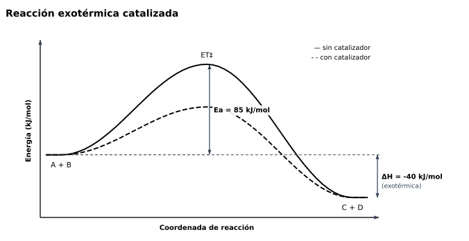
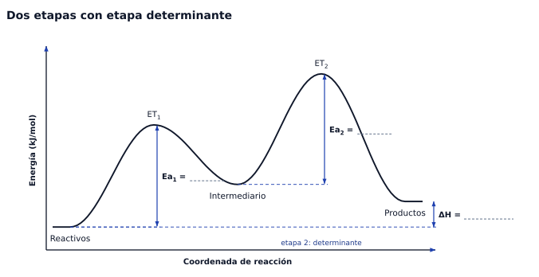

[Manual](../../README.md) › [Química](../README.md) › [Reacciones y cinética](README.md)

# Perfil de energía (`energy_profile`)

Dibuja el camino de una reacción: reactivos, intermediarios, estados de transición y
productos, unidos por curvas. Opcionalmente, un camino catalizado punteado, las energías de
activación de cada etapa y el ΔH, y la etapa determinante de la velocidad.

## Qué calcula

- La Ea de cada etapa, el ΔH y la etapa determinante (la de mayor Ea).

## Campos

| Campo | Tipo | Valores y valor por defecto | Descripción |
| :--- | :--- | :--- | :--- |
| `type` | texto | `energy_profile` | Obligatorio. |
| `states` | lista |  | Los estados en orden: `label`, `energy` y `ts: true` para un estado de transición. |
| `catalyzed` | lista |  | Otro camino, punteado (la misma forma que `states`). |
| `annotations` | lista |  | `Ea` (de cada etapa) y `dH`. |
| `unit` | texto |  | La unidad de energía (por omisión kJ/mol). |
| `showEnergies` | sí/no |  | Escribe la energía de cada estado. |
| `showRateDetermining` | sí/no |  | Marca la etapa determinante. |
| `xLabel` | texto |  | Rótulo del eje horizontal. |
| `yLabel` | texto |  | Rótulo del eje vertical. |
| `blankAnnotations` | sí/no |  | Deja en blanco las anotaciones. |

Además, los campos comunes a todos los tipos: `title`, `subtitle`, `id`, `inkSaver` y `theme` (ver [Campos comunes](../../campos-comunes.md)).

## Modo ejercicio

Campos que dejan casilleros para completar: `blankAnnotations`.

## Ejemplos

### Reacción exotérmica catalizada

```yaml
type: energy_profile
title: Reacción exotérmica catalizada
states:
  - {label: "A + B", energy: 0}
  - {label: "ET‡", energy: 85, ts: true}
  - {label: "C + D", energy: -40}
catalyzed:
  - {energy: 0}
  - {energy: 45, ts: true}
  - {energy: -40}
```

[](https://ingcom-unrn.github.io/dibu-web/#t=dHlwZTogZW5lcmd5X3Byb2ZpbGUKdGl0bGU6IFJlYWNjacOzbiBleG90w6lybWljYSBjYXRhbGl6YWRhCnN0YXRlczoKICAtIHtsYWJlbDogIkEgKyBCIiwgZW5lcmd5OiAwfQogIC0ge2xhYmVsOiAiRVTigKEiLCBlbmVyZ3k6IDg1LCB0czogdHJ1ZX0KICAtIHtsYWJlbDogIkMgKyBEIiwgZW5lcmd5OiAtNDB9CmNhdGFseXplZDoKICAtIHtlbmVyZ3k6IDB9CiAgLSB7ZW5lcmd5OiA0NSwgdHM6IHRydWV9CiAgLSB7ZW5lcmd5OiAtNDB9Cg)

[Abrir en el editor](https://ingcom-unrn.github.io/dibu-web/#t=dHlwZTogZW5lcmd5X3Byb2ZpbGUKdGl0bGU6IFJlYWNjacOzbiBleG90w6lybWljYSBjYXRhbGl6YWRhCnN0YXRlczoKICAtIHtsYWJlbDogIkEgKyBCIiwgZW5lcmd5OiAwfQogIC0ge2xhYmVsOiAiRVTigKEiLCBlbmVyZ3k6IDg1LCB0czogdHJ1ZX0KICAtIHtsYWJlbDogIkMgKyBEIiwgZW5lcmd5OiAtNDB9CmNhdGFseXplZDoKICAtIHtlbmVyZ3k6IDB9CiAgLSB7ZW5lcmd5OiA0NSwgdHM6IHRydWV9CiAgLSB7ZW5lcmd5OiAtNDB9Cg) para explorarlo y modificarlo.

### Dos etapas con etapa determinante

```yaml
type: energy_profile
title: Dos etapas con etapa determinante
states:
  - {label: Reactivos, energy: 0}
  - {label: "ET1", energy: 60, ts: true}
  - {label: Intermediario, energy: 25}
  - {label: "ET2", energy: 90, ts: true}
  - {label: Productos, energy: 15}
showRateDetermining: true
blankAnnotations: true
inkSaver: false
```

[](https://ingcom-unrn.github.io/dibu-web/#t=dHlwZTogZW5lcmd5X3Byb2ZpbGUKdGl0bGU6IERvcyBldGFwYXMgY29uIGV0YXBhIGRldGVybWluYW50ZQpzdGF0ZXM6CiAgLSB7bGFiZWw6IFJlYWN0aXZvcywgZW5lcmd5OiAwfQogIC0ge2xhYmVsOiAiRVQxIiwgZW5lcmd5OiA2MCwgdHM6IHRydWV9CiAgLSB7bGFiZWw6IEludGVybWVkaWFyaW8sIGVuZXJneTogMjV9CiAgLSB7bGFiZWw6ICJFVDIiLCBlbmVyZ3k6IDkwLCB0czogdHJ1ZX0KICAtIHtsYWJlbDogUHJvZHVjdG9zLCBlbmVyZ3k6IDE1fQpzaG93UmF0ZURldGVybWluaW5nOiB0cnVlCmJsYW5rQW5ub3RhdGlvbnM6IHRydWUKaW5rU2F2ZXI6IGZhbHNlCg)

[Abrir en el editor](https://ingcom-unrn.github.io/dibu-web/#t=dHlwZTogZW5lcmd5X3Byb2ZpbGUKdGl0bGU6IERvcyBldGFwYXMgY29uIGV0YXBhIGRldGVybWluYW50ZQpzdGF0ZXM6CiAgLSB7bGFiZWw6IFJlYWN0aXZvcywgZW5lcmd5OiAwfQogIC0ge2xhYmVsOiAiRVQxIiwgZW5lcmd5OiA2MCwgdHM6IHRydWV9CiAgLSB7bGFiZWw6IEludGVybWVkaWFyaW8sIGVuZXJneTogMjV9CiAgLSB7bGFiZWw6ICJFVDIiLCBlbmVyZ3k6IDkwLCB0czogdHJ1ZX0KICAtIHtsYWJlbDogUHJvZHVjdG9zLCBlbmVyZ3k6IDE1fQpzaG93UmF0ZURldGVybWluaW5nOiB0cnVlCmJsYW5rQW5ub3RhdGlvbnM6IHRydWUKaW5rU2F2ZXI6IGZhbHNlCg) para explorarlo y modificarlo.

## Ver también

[`reaction`](reaction.md), [`kinetics`](kinetics.md)
