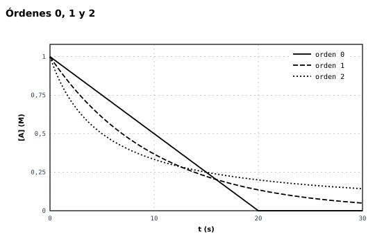
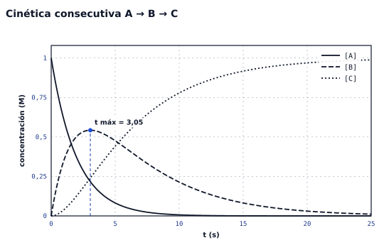
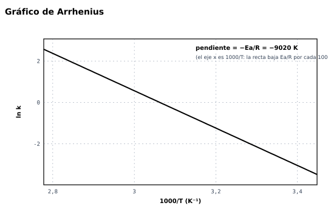

[Manual](../../README.md) › [Química](../README.md) › [Reacciones y cinética](README.md)

# Cinética (`kinetics`)

Dibuja la cinética de una reacción: la concentración en función del tiempo para orden 0, 1 o
2 (o varias curvas para comparar), su linealización, la gráfica de Arrhenius, o los modelos
consecutivo (A → B → C) y reversible.

## Qué calcula

- Las concentraciones integradas de cada orden y la vida media.
- En la linealización, la recta de cada orden con su pendiente.
- En el consecutivo, el máximo del intermediario; en Arrhenius, k a cada temperatura.

## Campos

| Campo | Tipo | Valores y valor por defecto | Descripción |
| :--- | :--- | :--- | :--- |
| `type` | texto | `kinetics` | Obligatorio. |
| `order` | número |  | El orden, 0, 1 o 2. |
| `k` | número |  | La constante de velocidad. |
| `A0` | número |  | La concentración inicial. |
| `curves` | lista |  | Varias curvas para comparar, cada una con su `order`, `k`, `A0` y `label`. |
| `plot` | texto |  | `linear` (la recta de cada orden) o `arrhenius`. |
| `Ea` | número |  | En Arrhenius, la energía de activación en kJ/mol. |
| `A` | número |  | En Arrhenius, el factor preexponencial. |
| `T` | lista |  | En Arrhenius, las temperaturas `[T1, T2]`. |
| `model` | texto |  | `consecutive` (A → B → C) o `reversible`. |
| `k1` | número |  | En el consecutivo, la constante de A → B. |
| `k2` | número |  | En el consecutivo, la constante de B → C. |
| `kf` | número |  | En el reversible, la constante directa. |
| `kb` | número |  | En el reversible, la constante inversa. |
| `species` | lista |  | Los nombres de las especies. |
| `showProduct` | sí/no |  | Dibuja también el producto. |
| `tEnd` | número |  | El tiempo final. |
| `annotations` | lista |  | `halfLife` marca la vida media. |
| `xLabel` | texto |  | Rótulo del eje horizontal. |
| `yLabel` | texto |  | Rótulo del eje vertical. |
| `blankAnnotations` | sí/no |  | Deja en blanco las anotaciones. |

Además, los campos comunes a todos los tipos: `title`, `subtitle`, `id`, `inkSaver` y `theme` (ver [Campos comunes](../../campos-comunes.md)).

## Modo ejercicio

Campos que dejan casilleros para completar: `blankAnnotations`.

## Ejemplos

### Órdenes 0, 1 y 2

```yaml
type: kinetics
title: Órdenes 0, 1 y 2
curves:
  - {order: 0, k: 0.05, A0: 1}
  - {order: 1, k: 0.1, A0: 1}
  - {order: 2, k: 0.2, A0: 1}
tEnd: 30
```

[](https://ingcom-unrn.github.io/dibu-web/#z=K6ksSLVSyM7MSy3JTC7mKsksyQHyD08uSknNSy1WMNBRMFSoVDDiSi4tKksttuJSUNBVqM4HyhZZgSSzgaSegamOgqOBlYJhLYq0IVTaEKusEVTWCC5b4pqXYqVgbMAFAA)

[Abrir en el editor](https://ingcom-unrn.github.io/dibu-web/#z=K6ksSLVSyM7MSy3JTC7mKsksyQHyD08uSknNSy1WMNBRMFSoVDDiSi4tKksttuJSUNBVqM4HyhZZgSSzgaSegamOgqOBlYJhLYq0IVTaEKusEVTWCC5b4pqXYqVgbMAFAA) para explorarlo y modificarlo.

### Cinética consecutiva A → B → C

```yaml
type: kinetics
title: Cinética consecutiva A → B → C
model: consecutive
k1: 0.5
k2: 0.2
inkSaver: false
```

[](https://ingcom-unrn.github.io/dibu-web/#z=K6ksSLVSyM7MSy3JTC7mKsksyQHynTPzDq8ECiQqJOfnFacml5ZkliUqOCo8apuk4AQmnbly81NSc6yQFKRyZRtaKRjomXJlG4FoI67MvOzgxLLUIiuFtMSc4lQuAA)

[Abrir en el editor](https://ingcom-unrn.github.io/dibu-web/#z=K6ksSLVSyM7MSy3JTC7mKsksyQHynTPzDq8ECiQqJOfnFacml5ZkliUqOCo8apuk4AQmnbly81NSc6yQFKRyZRtaKRjomXJlG4FoI67MvOzgxLLUIiuFtMSc4lQuAA) para explorarlo y modificarlo.

### Gráfico de Arrhenius

```yaml
type: kinetics
title: Gráfico de Arrhenius
plot: arrhenius
Ea: 75
A: 1.0e+12
T: [290, 360]
```

[](https://ingcom-unrn.github.io/dibu-web/#z=K6ksSLVSyM7MSy3JTC7mKsksyQHy3YsOL0zLTM5XSElVcCwqykjNyywt5irIyS-xUkiE810TrRTMTbkcrRQM9QxStQ2NuEKsFKKNLA10FIzNDGK5AA)

[Abrir en el editor](https://ingcom-unrn.github.io/dibu-web/#z=K6ksSLVSyM7MSy3JTC7mKsksyQHy3YsOL0zLTM5XSElVcCwqykjNyywt5irIyS-xUkiE810TrRTMTbkcrRQM9QxStQ2NuEKsFKKNLA10FIzNDGK5AA) para explorarlo y modificarlo.

## Ver también

[`reaction`](reaction.md), [`energy_profile`](energy_profile.md)
