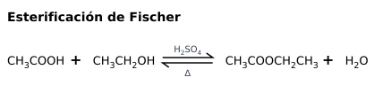
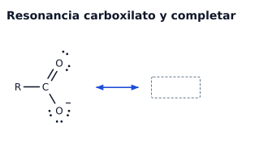

[Manual](../../README.md) › [Química](../README.md) › [Reacciones y cinética](README.md)

# Reacción (`reaction`)

Dibuja una ecuación química o un mecanismo: fórmulas, signos más, moléculas dibujadas (como
las de [`molecule`](../estructura/molecule.md)) y flechas de reacción, equilibrio, resonancia o
retrosíntesis con texto arriba y abajo. Un casillero en blanco deja un producto para completar.

## Campos

| Campo | Tipo | Valores y valor por defecto | Descripción |
| :--- | :--- | :--- | :--- |
| `type` | texto | `reaction` | Obligatorio. |
| `steps` | lista |  | Los elementos en orden: fórmulas, `"+"`, moléculas (bloques de `molecule`), `{arrow: "->", "<=>", "<->" (resonancia) o "=>" (retrosíntesis), above, below, blank}` y `{blank: true, width}` (un producto para completar). |
| `maxWidth` | número |  | El ancho máximo; más largo, la ecuación sigue en otro renglón. |

Además, los campos comunes a todos los tipos: `title`, `subtitle`, `id`, `inkSaver` y `theme` (ver [Campos comunes](../../campos-comunes.md)).

## Ejemplos

### Esterificación de Fischer

```yaml
type: reaction
title: Esterificación de Fischer
steps:
  - "CH3COOH"
  - "+"
  - "CH3CH2OH"
  - {arrow: "<=>", above: "H2SO4", below: "Δ"}
  - "CH3COOCH2CH3"
  - "+"
  - "H2O"
```

[](https://ingcom-unrn.github.io/dibu-web/#t=dHlwZTogcmVhY3Rpb24KdGl0bGU6IEVzdGVyaWZpY2FjacOzbiBkZSBGaXNjaGVyCnN0ZXBzOgogIC0gIkNIM0NPT0giCiAgLSAiKyIKICAtICJDSDNDSDJPSCIKICAtIHthcnJvdzogIjw9PiIsIGFib3ZlOiAiSDJTTzQiLCBiZWxvdzogIs6UIn0KICAtICJDSDNDT09DSDJDSDMiCiAgLSAiKyIKICAtICJIMk8iCg)

[Abrir en el editor](https://ingcom-unrn.github.io/dibu-web/#t=dHlwZTogcmVhY3Rpb24KdGl0bGU6IEVzdGVyaWZpY2FjacOzbiBkZSBGaXNjaGVyCnN0ZXBzOgogIC0gIkNIM0NPT0giCiAgLSAiKyIKICAtICJDSDNDSDJPSCIKICAtIHthcnJvdzogIjw9PiIsIGFib3ZlOiAiSDJTTzQiLCBiZWxvdzogIs6UIn0KICAtICJDSDNDT09DSDJDSDMiCiAgLSAiKyIKICAtICJIMk8iCg) para explorarlo y modificarlo.

### Resonancia carboxilato y completar

```yaml
type: reaction
title: Resonancia carboxilato y completar
steps:
  - atoms:
      - {id: c, el: C, at: [0, 0]}
      - {id: r, el: R, from: c, angle: 180}
      - {id: o1, el: O, from: c, angle: 60, bond: 2, lonePairs: 2}
      - {id: o2, el: O, from: c, angle: 300, lonePairs: 3, charge: -1}
  - {arrow: "<->"}
  - {blank: true, width: 60}
inkSaver: false
```

[](https://ingcom-unrn.github.io/dibu-web/#t=dHlwZTogcmVhY3Rpb24KdGl0bGU6IFJlc29uYW5jaWEgY2FyYm94aWxhdG8geSBjb21wbGV0YXIKc3RlcHM6CiAgLSBhdG9tczoKICAgICAgLSB7aWQ6IGMsIGVsOiBDLCBhdDogWzAsIDBdfQogICAgICAtIHtpZDogciwgZWw6IFIsIGZyb206IGMsIGFuZ2xlOiAxODB9CiAgICAgIC0ge2lkOiBvMSwgZWw6IE8sIGZyb206IGMsIGFuZ2xlOiA2MCwgYm9uZDogMiwgbG9uZVBhaXJzOiAyfQogICAgICAtIHtpZDogbzIsIGVsOiBPLCBmcm9tOiBjLCBhbmdsZTogMzAwLCBsb25lUGFpcnM6IDMsIGNoYXJnZTogLTF9CiAgLSB7YXJyb3c6ICI8LT4ifQogIC0ge2JsYW5rOiB0cnVlLCB3aWR0aDogNjB9Cmlua1NhdmVyOiBmYWxzZQo)

[Abrir en el editor](https://ingcom-unrn.github.io/dibu-web/#t=dHlwZTogcmVhY3Rpb24KdGl0bGU6IFJlc29uYW5jaWEgY2FyYm94aWxhdG8geSBjb21wbGV0YXIKc3RlcHM6CiAgLSBhdG9tczoKICAgICAgLSB7aWQ6IGMsIGVsOiBDLCBhdDogWzAsIDBdfQogICAgICAtIHtpZDogciwgZWw6IFIsIGZyb206IGMsIGFuZ2xlOiAxODB9CiAgICAgIC0ge2lkOiBvMSwgZWw6IE8sIGZyb206IGMsIGFuZ2xlOiA2MCwgYm9uZDogMiwgbG9uZVBhaXJzOiAyfQogICAgICAtIHtpZDogbzIsIGVsOiBPLCBmcm9tOiBjLCBhbmdsZTogMzAwLCBsb25lUGFpcnM6IDMsIGNoYXJnZTogLTF9CiAgLSB7YXJyb3c6ICI8LT4ifQogIC0ge2JsYW5rOiB0cnVlLCB3aWR0aDogNjB9Cmlua1NhdmVyOiBmYWxzZQo) para explorarlo y modificarlo.

## Ver también

[`energy_profile`](energy_profile.md), [`kinetics`](kinetics.md)
