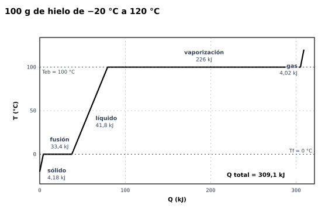
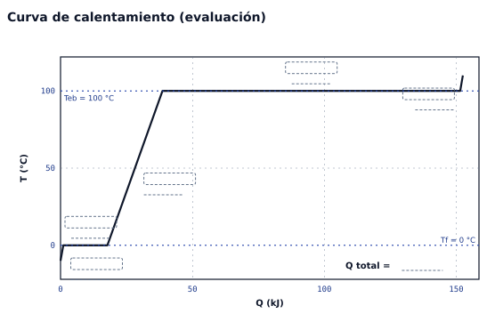

[Manual](../../README.md) › [Química](../README.md) › [Termodinámica](README.md)

# Curva de calentamiento (`heating_curve`)

Dibuja la curva de calentamiento de una masa de sustancia, desde una temperatura inicial hasta
una final: los tramos en cada fase y las mesetas de fusión y ebullición, con el calor de cada
tramo y el total.

## Qué calcula

- El calor de cada tramo (m·c·ΔT y m·ΔH) y el total.

## Campos

| Campo | Tipo | Valores y valor por defecto | Descripción |
| :--- | :--- | :--- | :--- |
| `type` | texto | `heating_curve` | Obligatorio. |
| `substance` | texto |  | Una sustancia conocida, `water`. |
| `cpSolid` | número |  | El calor específico del sólido, en J/g·K. |
| `cpLiquid` | número |  | El calor específico del líquido. |
| `cpGas` | número |  | El calor específico del gas. |
| `melting` | número |  | La temperatura de fusión, en °C. |
| `boiling` | número |  | La temperatura de ebullición. |
| `hFusion` | número |  | El calor de fusión, en J/g. |
| `hVaporization` | número |  | El calor de vaporización. |
| `mass` | número |  | La masa, en g. |
| `from` | número |  | La temperatura inicial. |
| `to` | número |  | La temperatura final. |
| `showHeat` | sí/no |  | Escribe el calor de cada tramo. |
| `showTotal` | sí/no |  | Escribe el calor total. |
| `blankHeat` | sí/no |  | Deja en blanco los calores. |
| `blankPhases` | sí/no |  | Deja en blanco los nombres de las fases. |

Además, los campos comunes a todos los tipos: `title`, `subtitle`, `id`, `inkSaver` y `theme` (ver [Campos comunes](../../campos-comunes.md)).

## Modo ejercicio

Campos que dejan casilleros para completar: `blankHeat`, `blankPhases`.

## Ejemplos

### 100 g de hielo de −20 °C a 120 °C

```yaml
type: heating_curve
title: 100 g de hielo de −20 °C a 120 °C
substance: water
mass: 100
from: -20
to: 120
```

[](https://ingcom-unrn.github.io/dibu-web/#z=K6ksSLVSyEhNLMnMS49PLi0qS-UqySzJAQoaGhgopCukpCpkZKbm5IMYjzomGRkoHNrgrJCoYAhhcRWXJhWXJOYlAzWUJ5akFnHlJhYXgzVzpRXl51op6BoZcJXkW4E0cAEA)

[Abrir en el editor](https://ingcom-unrn.github.io/dibu-web/#z=K6ksSLVSyEhNLMnMS49PLi0qS-UqySzJAQoaGhgopCukpCpkZKbm5IMYjzomGRkoHNrgrJCoYAhhcRWXJhWXJOYlAzWUJ5akFnHlJhYXgzVzpRXl51op6BoZcJXkW4E0cAEA) para explorarlo y modificarlo.

### Curva de calentamiento (evaluación)

```yaml
type: heating_curve
title: Curva de calentamiento (evaluación)
substance: water
mass: 50
from: -10
to: 110
blankHeat: true
blankPhases: true
inkSaver: false
```

[](https://ingcom-unrn.github.io/dibu-web/#z=LY07DsIwEER7n2JLKJCSgsYtDSUSB0ATsyFW_EHetSPOxRG4GJagmdF7Gmn09WRLC0N9etxcLY2Neg1dnjqA7kwOgZMi-p6ZdtwQKpz_vNPeSJ1EkVzfb1AuJkLE0nEwc8nR0mEcjGZLY-8pIK3nfmVJS-UfXxYIy9_4tF7RuFiaEYTNFw)

[Abrir en el editor](https://ingcom-unrn.github.io/dibu-web/#z=LY07DsIwEER7n2JLKJCSgsYtDSUSB0ATsyFW_EHetSPOxRG4GJagmdF7Gmn09WRLC0N9etxcLY2Neg1dnjqA7kwOgZMi-p6ZdtwQKpz_vNPeSJ1EkVzfb1AuJkLE0nEwc8nR0mEcjGZLY-8pIK3nfmVJS-UfXxYIy9_4tF7RuFiaEYTNFw) para explorarlo y modificarlo.

## Ver también

[`phase_diagram`](phase_diagram.md)
