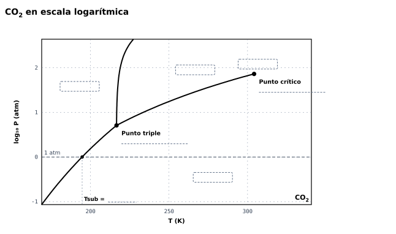
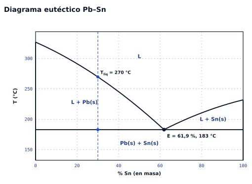

[Manual](../../README.md) › [Química](../README.md) › [Termodinámica](README.md)

# Diagrama de fases (`phase_diagram`)

Dibuja el diagrama P-T de una sustancia con las curvas de fusión, vaporización y sublimación,
los puntos triple y crítico y las regiones sólido, líquido y gas; o, con `kind: eutectic`, el
diagrama de dos componentes con su punto eutéctico y una curva de enfriamiento.

## Qué calcula

- Las curvas, ajustadas a los puntos triple, crítico y normales.

## Campos

| Campo | Tipo | Valores y valor por defecto | Descripción |
| :--- | :--- | :--- | :--- |
| `type` | texto | `phase_diagram` | Obligatorio. |
| `kind` | texto |  | `substance` (por omisión) o `eutectic`. |
| `substance` | texto |  | Una sustancia conocida, `water` o `co2`. |
| `triple` | lista |  | El punto triple, `[T en K, P en atm]`. |
| `critical` | lista |  | El punto crítico. |
| `meltingSlope` | número |  | La pendiente de la curva de fusión (negativa en el agua). |
| `normalMelting` | número |  | La temperatura normal de fusión. |
| `normalBoiling` | número |  | La temperatura normal de ebullición. |
| `normalSublimation` | número |  | La temperatura normal de sublimación. |
| `scale` | texto |  | `schematic` (por omisión) o `log` (presión en escala logarítmica). |
| `atm` | sí/no |  | Dibuja la recta de 1 atm. |
| `points` | lista |  | Puntos marcados: `T`, `P` y `label`. |
| `supercritical` | sí/no |  | Marca la región supercrítica. |
| `blankRegions` | sí/no |  | Deja en blanco los nombres de las regiones. |
| `blankPoints` | sí/no |  | Deja en blanco los puntos. |
| `components` | lista |  | En `eutectic`, los dos componentes. |
| `meltingA` | número |  | En `eutectic`, la fusión del componente A. |
| `meltingB` | número |  | En `eutectic`, la fusión del componente B. |
| `eutectic` | lista |  | En `eutectic`, el punto eutéctico `[x %, T]`. |
| `cooling` | número |  | En `eutectic`, una composición para dibujar su enfriamiento. |
| `blankCooling` | sí/no |  | En `eutectic`, deja en blanco el enfriamiento. |
| `yLabel` | texto |  | Rótulo del eje vertical. |

Además, los campos comunes a todos los tipos: `title`, `subtitle`, `id`, `inkSaver` y `theme` (ver [Campos comunes](../../campos-comunes.md)).

## Modo ejercicio

Campos que dejan casilleros para completar: `blankRegions`, `blankPoints`, `blankCooling`.

## Ejemplos

### CO2 en escala logarítmica

```yaml
type: phase_diagram
title: CO2 en escala logarítmica
substance: co2
scale: log
blankRegions: true
blankPoints: true
```

[](https://ingcom-unrn.github.io/dibu-web/#z=NcrBDYMwDEbhe6bwDBxzZQCqLoB-ghUsgoNic2CoTtHFmqrq7enT8_vkSOcG43kV5IYjuHjpOE4DsRJbQgGVmtHeLz8kIdi1mENTv1Idwvfo2ZewFOj-5CxVLZK3i3_0qKL-lw8)

[Abrir en el editor](https://ingcom-unrn.github.io/dibu-web/#z=NcrBDYMwDEbhe6bwDBxzZQCqLoB-ghUsgoNic2CoTtHFmqrq7enT8_vkSOcG43kV5IYjuHjpOE4DsRJbQgGVmtHeLz8kIdi1mENTv1Idwvfo2ZewFOj-5CxVLZK3i3_0qKL-lw8) para explorarlo y modificarlo.

### Diagrama eutéctico Pb–Sn

```yaml
type: phase_diagram
kind: eutectic
title: Diagrama eutéctico Pb–Sn
components: [Pb, Sn]
meltingA: 327
meltingB: 232
eutectic: [61.9, 183]
cooling: 30
inkSaver: false
```

[](https://ingcom-unrn.github.io/dibu-web/#z=K6ksSLVSKMhILE6NT8lMTC9KzOXKzsxLsVJILS1JTS7JTOYqySzJAapxgcgmgiQOrwTJ5CsEJD1qmBycx5Wcn1uQn5eaV1JspRAdkKSjEJwXy5WbmlOSmZfuaKVgbGQO4zlZKRgZG3HBDAcqNzPUs9RRMLQwjgUak58DVAPUYMCVmZcdnFiWWmSlkJaYU5zKBQA)

[Abrir en el editor](https://ingcom-unrn.github.io/dibu-web/#z=K6ksSLVSKMhILE6NT8lMTC9KzOXKzsxLsVJILS1JTS7JTOYqySzJAapxgcgmgiQOrwTJ5CsEJD1qmBycx5Wcn1uQn5eaV1JspRAdkKSjEJwXy5WbmlOSmZfuaKVgbGQO4zlZKRgZG3HBDAcqNzPUs9RRMLQwjgUak58DVAPUYMCVmZcdnFiWWmSlkJaYU5zKBQA) para explorarlo y modificarlo.

## Ver también

[`heating_curve`](heating_curve.md)
